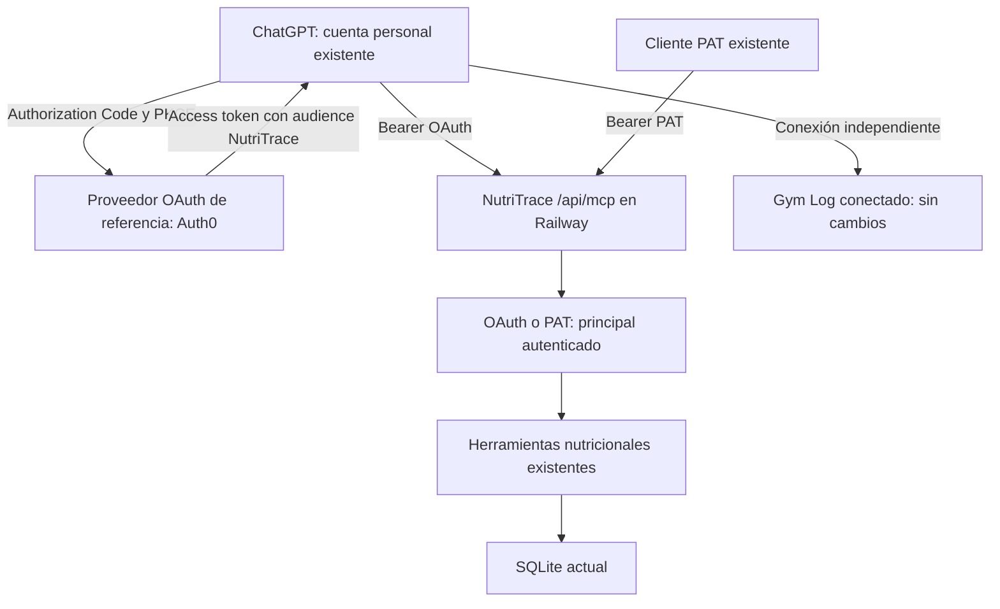

# NutriTrace personal e integración con Gym Log

Fecha de auditoría: 2026-10-24. Implementación local: 2026-10-25, America/Mexico_City. Estado: código implementado; publicación Git autorizada el 2026-10-25; conexión real con ChatGPT pendiente. La publicación no configura Auth0 ni variables privadas.

## 0. Estado de ejecución y cambios respecto de la propuesta

El propietario aprobó implementar el alcance completo mediante la solicitud adjunta «IMPLEMENTACIÓN COMPLETA — NutriTrace + Gym Log + ChatGPT». Las secciones de auditoría y fases siguientes conservan el diseño y su contexto histórico; sus frases «no se modificó código»/«pendiente de aprobación» describen **aquella auditoría**, no el estado actual. La autoridad de ejecución actual es esta sección y [el reporte de verificación](IMPLEMENTATION_STATUS.md).

Implementado localmente:

- Gym: notas de método/dispositivo en alta, edición e historial; conserva fecha/unidad al editar únicamente notas. Preparador de los cinco tipos BIA con controles de duplicados, IDs y unidades e instrucciones MCP idempotentes, sin escrituras en producción. [Catálogo controlado](../../gym-log/docs/body-bia-catalog.md).
- NutriTrace: `BODY_MEASUREMENTS_SOURCE=internal|gym-log`, default original; UI, Wizard, avisos de cambios corporales pendientes, bloqueo servidor/MCP, conservación de nutrición y legado, metas fijas y cálculos no disponibles si requieren una serie corporal canónica. Se mantiene wellness no corporal, incluido Body Battery Garmin.
- La defensa común usa funciones y triggers **TEMP de conexión SQLite**, además de política HTTP y guardas MCP. No añade tablas persistentes ni migraciones. Esta es la concreción del control de fronteras: protege también escritores de proveedores/importación existentes sin replicar filtros en cada función. La importación de diario cambió de REPLACE a upsert para preservar cuerpo legado.
- OAuth resource server con JWT/JWKS, metadata raíz/sufijo, PKCE delegado al proveedor, mapping explícito de dueño/cuenta, scopes por llamada y challenge; PAT sigue disponible. Se corrigió la lectura accidental con scopes solo de escritura. La ampliación aprobada concede destroy nutricional con scope, flag y confirmación. Sincronización entre apps y get_body_stats siguen fuera de alcance.
- Nueva `set_nutrition_goals`: comparación esperada y transacción, permiso adicional explícito, targets diarios acotados; sin cambiar medidas, TDEE ni otras preferencias.
- Se conservaron registro frecuente, comidas/recetas/porciones, snacks independientes, correcciones en UI y offline originales. [Uso personal y configuración](PERSONAL_NUTRITION.md). No se cargaron alimentos mexicanos ficticios ni datos reales.
- Dockerfile raíz usa código del fork y locks con `npm ci`; se excluyen del contexto datos, backups y secretos. Docker no está disponible en WSL: el build de **imagen** queda por verificar; no se sustituye ese resultado por el build PWA.

Guías finales: [Auth0, variables, ChatGPT, refresh y revocación](chatgpt-mcp.md), [publicación, backup y rollback](../DEPLOY.md). La instalación real en Auth0/ChatGPT, las escrituras del catálogo real, restauración real y prueba en teléfono no se ejecutaron. Ningún valor privado ni archivo de entorno real fue necesario. Los builds se realizan en copias aisladas que excluyen `.env`, datos y credenciales.

### Ampliación aprobada antes de publicar (2026-10-25)

La decisión posterior del propietario habilita administración nutricional OAuth: `create_food`, `edit_diary_entry` y `delete_diary_entry`, con `mcp:destroy`, `MCP_DESTROY_ENABLED=1` y `confirm:true`. Esta decisión sustituye las exclusiones OAuth/destroy y la limitación a UI de correcciones/catálogo de la propuesta histórica que sigue. La API Auth0 y el grant del dueño deben añadir ese scope; no se modifica el tenant automáticamente.

Editar/borrar exige `expected_revision` obtenido de `items_revision` al consultar el diario y selecciona preferentemente `entry_id` por UUID. El servidor relee y compara dentro de la transacción del usuario/día; rechaza índices/revisiones obsoletos. Se conservan agua, notas, legado corporal y el día. Los UUID borrados quedan en tombstones de sync. También cambia el contrato PAT: no se aceptan índices sin revisión. No hay herramientas para días completos, historiales, bases de datos o medidas corporales; Gym sigue como única fuente corporal. Véanse [contrato y configuración vigentes](chatgpt-mcp.md).

## 1. Recomendación

**Entrega indispensable: conectar NutriTrace directamente como aplicación MCP privada de ChatGPT mediante OAuth 2.1, para consultar y registrar nutrición desde conversaciones compatibles, sin VS Code ni Codex.** Gym Log ya funciona como aplicación conectada, según el usuario; sirve de referencia de autenticación y se conserva sin modificaciones.

Prioridad acordada: **ChatGPT + NutriTrace > integración entre aplicaciones > personalización visual**. ChatGPT podrá consultar Gym Log y NutriTrace como aplicaciones independientes cuando ambas estén habilitadas. No hace falta que NutriTrace consulte Gym para esta entrega.

Conservar NutriTrace en Railway con SQLite y su endpoint `/api/mcp`. Añadir autenticación OAuth al transporte, manteniendo los PAT para clientes existentes y reutilizando los handlers nutricionales. Reutilizar preferentemente el tenant/proveedor OAuth de Gym, con API/audience, cliente y permisos propios de NutriTrace; no copiar su implementación Next.js ni crear un servidor de autorización casero. La viabilidad de escritura depende también del plan y permisos efectivos de ChatGPT; véase sección 9.

No desarrollar otro registrador nutricional: el fork ya incluye alimentos, comidas, recetas, porciones, nutrientes, favoritos, recientes, diario, peso, metas, estadísticas, PWA offline y asistente propio. El trabajo inicial se concentra en OAuth, descubrimiento, permisos y verificación de lectura/escritura nutricional desde ChatGPT, respetando la fuente única de medidas. El catálogo mexicano y los cambios visuales se posponen.

**Decisión de producto confirmada:** Gym Log es la única aplicación de registro de peso, perímetros y composición corporal. NutriTrace conserva alimentación, recetas, nutrientes y metas nutricionales. ChatGPT debe registrar medidas exclusivamente mediante Gym. No crear nuevas lecturas de peso manual ni escritura de medidas en el MCP OAuth NutriTrace. La primera entrega usará metas calóricas fijas explícitas y no necesita conexión directa entre servidores; un peso actual externo para cálculos internos será una mejora independiente si aporta utilidad. No recomendar un backend compartido ni un segundo historial corporal.

## 2. Alcance, evidencia y límites

Repositorios identificados por su código y documentación:

| Proyecto | Ruta | Revisión local | Rama |
|---|---|---|---|
| NutriTrace | `nutritrace/` | `888c966` | `feature/personalizacion-nutricion` |
| Entrenamiento: Gym Log | `gym-log/` | `9924138` | `main` |

Ambos árboles estaban limpios al comenzar. NutriTrace tiene cero commits de diferencia respecto de la referencia local `origin/main`; esto no demuestra que esté actualizado respecto al servidor remoto ni al upstream TraceApps. No se hizo fetch ni se inspeccionaron URLs de remotos.

Se revisaron manifiestos, estructura, rutas, esquemas declarados, servicios, middleware, herramientas MCP, documentación y pruebas seleccionadas como texto. Se siguió `gym-log/AGENTS.md`; no se escribió código Next.js. El archivo abierto en el IDE de otro proyecto no se necesitó.

No se leyeron archivos de entorno, credenciales, configuraciones personales de clientes MCP, datos privados, backups ni bases de datos. No se iniciaron aplicaciones, ejecutaron migraciones, instalaron dependencias, llamaron APIs privadas ni realizaron despliegues. Este documento es el único cambio solicitado.

**Verificado estáticamente** significa presente en el código local, no probado en ejecución. **Declarado por el usuario**: producción en Netlify/Railway, SQLite persistente, MCP nutricional habilitado con lectura/escritura y Gym Log funcionando como aplicación conectada de ChatGPT. **Pendiente**: versiones efectivamente desplegadas, flags, scopes concedidos, montajes persistentes, restauración y configuración efectiva del proveedor OAuth. No se afirma haber auditado producción. Las revisiones añaden investigación de documentación oficial y, en esta última, rastreo de tipos/unidades Gym, formularios y consumidores de peso NutriTrace. Todo sigue siendo exclusivamente documental. No se inspeccionaron tipos reales del usuario ni qué proveedores tiene conectados; las capacidades descritas provienen del código.

Incluso una consulta MCP autenticada de NutriTrace actualiza `api_tokens.last_used_at`; por ello no se hicieron probes autenticados durante esta auditoría, respetando la restricción de no alterar las bases existentes.

## 3. Inventario de las aplicaciones

### 3.1 Gym Log

Stack declarado en [package.json](../../gym-log/package.json): Next.js 16.2.10, React 19.2.4, TypeScript, NextAuth 4, Dexie 4, Google APIs, Zod 4, `jose`, SDK MCP 1.29 y Vitest. Versiones de manifiesto; los rangos no identifican por sí solos la versión instalada.

Estructura y responsabilidades:

- `src/app/page.tsx`, estilos y `src/lib/workouts.ts`: aplicación de entrenamiento; planes, secciones, divisores, ejercicios, series objetivo, sesiones, descansos y sustituciones.
- `src/lib/db.ts`, `sync.ts`, `offline.ts`: IndexedDB/Dexie, cola local, funcionamiento offline y sincronización.
- `src/lib/types.ts`, `domain.ts`: entidades y reglas compartidas.
- `src/server/google.ts`, `sync-protocol.ts`, `sync-log.ts`: almacenamiento remoto y revisiones.
- `src/server/tools/`: validación, autenticación REST, servicios, repositorio e idempotencia.
- `src/server/mcp/`, `src/app/mcp/`, rutas `.well-known`: adaptador MCP y OAuth.
- `docs/ai-tools-api.md`, `docs/chatgpt-mcp.md`, `openapi.yaml`: contratos existentes. Algunas secciones antiguas del README hablan de Vercel; eso no sustituye el contexto de Netlify dado por el usuario.

Almacenamiento real: **Google Sheets para entidades estructuradas y Google Drive para imágenes**, no solamente archivos genéricos en Drive. IndexedDB es la base operativa local y puede contener cambios aún no enviados. Sheets es la referencia remota que ve una integración; no conoce cambios pendientes del teléfono.

Las hojas guardan `id`, `updatedAt`, `json`; existen revisiones, registro `SyncOperations`, huellas de mutación y tombstones. Los IDs son cadenas/UUID. `WorkoutExercise` conserva snapshots históricos; cambiar un ejercicio o rutina no debe reconstruir el historial. Las fotos e imágenes de ejercicios se sirven mediante endpoints autenticados.

Autenticación diferenciada:

| Superficie | Mecanismo | Observaciones |
|---|---|---|
| PWA | NextAuth + Google Login; correo permitido | `ALLOWED_EMAIL` restringe al propietario. El proxy deja pasar si falta esa variable: revisar configuración sin extraer su valor |
| `/api/tools/*` | Bearer estático exclusivo; comparación temporalmente segura | Un único permiso efectivo para lectura y escritura; no es una credencial de solo lectura |
| `/mcp` | JWT OAuth, integración prevista con Auth0 | Firma RS256, issuer, audience canónica, tiempos del JWT, `sub` propietario y scopes por operación |
| Acceso a Google | Cuenta de servicio para Sheets; OAuth o cuenta de servicio para Drive | Credenciales exclusivamente servidor; no trasladarlas a NutriTrace |

Fuentes: [tipos](../../gym-log/src/lib/types.ts), [Google](../../gym-log/src/server/google.ts), [autenticación PWA](../../gym-log/src/app/api/auth/[...nextauth]/route.ts), [proxy](../../gym-log/src/proxy.ts), [auth REST](../../gym-log/src/server/tools/auth.ts), [auth MCP](../../gym-log/src/server/mcp/auth.ts).

### 3.2 NutriTrace

Stack declarado: Svelte 5.55.9, Vite 6.4.3, SPA, Chart.js, PWA/Workbox e internacionalización; Capacitor 8 para Android. Servidor Express 5.2.1 sobre Node, `better-sqlite3` 9, JWT, bcrypt, OIDC, Zod y SDK MCP 1.30. DuckDB se usa para un catálogo OFF local opcional, no como sustituto de SQLite. Docker raíz construye frontend y servidor en una imagen con Node 20.

Estructura:

- `src/routes/Diary.svelte`, `Foods.svelte`, `MealEditor.svelte`, `Statistics.svelte`, `Wellness.svelte`, `settings/`: interfaz y ajustes.
- `src/components/diary/`, `foods/`, `ui/`: registro rápido, escáner, tarjetas y paneles.
- `src/lib/nutrition.js`, `goal-resolver.js`, `body-stats-unit.js`: cálculo nutricional, metas y unidades existentes.
- `src/lib/offline-api.js`, `offline-edits.js`, `sync.js`: espejo offline del navegador y reconciliación.
- `server/db.js`: tablas y migraciones al importar el módulo. **No importarlo durante una auditoría contra una ruta real**.
- `server/routes/`, `server/routes/api/v1/`, `server/lib/mcp/`: API interna, API externa y MCP.
- `src/lib/aiChat.js`, `quick-log.js`, `server/routes/ai.js`: asistente propio y registro por lenguaje natural. Es una superficie distinta del servidor MCP.

Tablas relevantes: `foods` con nutrición JSON por porción, `meals` con elementos/recetas/rendimiento, `diary` por usuario y fecha con `items`, `water`, `body_stats`; `user_settings` con metas y preferencias; `users` con perfil; `wellness_data` por fecha, proveedor y métrica; `workouts`; tombstones; tokens API y webhooks. Los IDs principales son enteros; los elementos del diario tienen UUID para reconciliación. Existen fotos/uploads y backups que requieren persistencia aparte del archivo SQLite.

Servidor SQLite en WAL, claves foráneas activas y migraciones embebidas. PWA usa un espejo IndexedDB con outbox; Android dispone de SQLite local y sincronización propia. No confundir esos mecanismos internos ya existentes con una futura sincronización entre aplicaciones.

Autenticación: cuentas con bcrypt, sesión JWT mediante cookie `nt_token` HttpOnly/Secure según configuración o Bearer de sesión para Android; CSRF para cookies, con excepciones y compatibilidad para sesiones antiguas. OIDC es opcional. Los PAT externos se generan con aleatoriedad de 256 bits, se guardan como SHA-256 y están asociados a una cuenta; admiten caducidad y revocación. Solo un admin autenticado puede crear PAT. Tener un único usuario **no equivale** a activar el modo anónimo «single-user»: ese modo deja pasar `requireAuth` y no permite crear PAT sin cuenta real. No se recomienda desactivar cuentas en un Railway público.

Fuentes: [manifiesto](../package.json), [servidor](../server/package.json), [DB declarada](../server/db.js), [autenticación](../server/middleware/auth.js), [CSRF](../server/middleware/csrf.js), [PAT](../server/lib/api-tokens.js), [gestión PAT](../server/routes/api-tokens.js), [Docker](../Dockerfile), [arquitectura](../ARCHITECTURE.md).

## 4. APIs disponibles

### 4.1 Gym Log

La [API documentada](../../gym-log/docs/ai-tools-api.md) reutiliza `GymApplicationService → RemoteGymRepository → readSnapshot/applyOperations`; funciona sin navegador abierto y no usa Dexie en servidor.

| Método/ruta | Capacidad aprovechable |
|---|---|
| `GET /api/tools/active-plan`, `/plans`, `/plans/{id}`, `/sections/{id}` | Rutina actual |
| `GET /api/tools/exercises`, `/{id}`, `/{id}/history`, `/{id}/progress` | Catálogo, historial y progreso determinista |
| `GET /api/tools/workouts/recent`, `/workouts/{id}` | Sesiones e historial detallado, filtros y paginación |
| `GET /api/tools/body/measurement-types`, `/body/measurements` | Tipos personalizados, unidades e historial de medidas |
| `GET /api/tools/progress-photos`, endpoints de imágenes | Metadatos/fotos privadas; no necesarios para el asesor inicial |
| `POST /api/tools/training-context` | Consulta compacta configurable, aunque use POST; no es una escritura |
| `POST/PATCH/DELETE /api/tools/...` | Crear/editar/archivar rutinas, ejercicios, elementos y mediciones; fuera del permiso necesario para nutrición |
| `/api/sync`, `/api/images` | Superficie propia de la PWA; no usar para integrar NutriTrace |
| `/mcp`, `/.well-known/oauth-protected-resource` y variante `/mcp` | Transporte MCP y descubrimiento OAuth |

REST responde `{ok,data}` o error estructurado; no asumir la misma envoltura que NutriTrace. Escrituras admiten `Idempotency-Key` y conflictos 409. No escribir JSON directamente en celdas ni emplear Drive como interfaz de dominio.

Limitaciones verificadas: cada snapshot lee las entidades remotas disponibles, aunque la respuesta final sea compacta. Evitar muchos endpoints sucesivos y polling. `get_training_context` limita resultados y no contiene todo el historial; su contador de 28 días no filtra por estado. Las consultas de sesiones recientes excluyen activas y exigen alguna serie completada, pero pueden incluir canceladas. No utilizar ese contador como «sesiones completadas» sin normalización. La duración de resumen resta `totalPausedSeconds` del intervalo inicio/fin; no representa exclusivamente tiempo bajo esfuerzo. Los filtros de fecha de sesiones usan `startedAt.slice(0,10)`: el adaptador debe resolver explícitamente el día mexicano. No existe gasto calórico medido en el modelo `Workout`.

### 4.2 NutriTrace

| Superficie | Capacidades y permiso |
|---|---|
| `/api/foods`, `/api/meals`, `/api/diary`, `/api/settings`, `/api/activity`, `/api/fasts` | CRUD interno de la app; sesión/CSRF. Mantenerlo interno |
| `/api/sync/pull`, `/api/sync/push` | Sincronización con clientes propios; no es un contrato de integración Gym |
| `GET /api/v1/foods?q=...` | Catálogo, scope `read:foods`; federación |
| `POST /api/v1/workouts` | Scope `write:workouts`; calorías obligatorias; upsert por usuario/origen/ID externo |
| `POST /api/v1/activity` | Scope `write:activity`; actividad manual, distinta de workouts |
| `POST /api/v1/body-measurements` | Scope `write:body-measurements`; escribe estadísticas y espejo wellness |
| `GET /api/v1/diary/:date`, `/:date/totals`, `/goals` | `PUBLIC_API_ENABLED` + `mcp:read` |
| `GET /api/v1/meals/search`, `/recent`, `/:id` | Biblioteca, recetas opcionales; mismos flags/scopes de lectura |
| `GET /api/v1/steps`, `/body-composition`, `/profile` | Observaciones por fuente y perfil; mismos flags/scopes de lectura |
| `POST /api/v1/diary/:date/food`, `/water`, `/meal`; `PUT .../body-stat` | API pública habilitada, flag adicional `PUBLIC_API_WRITE_ENABLED`, scope `mcp:write` |
| `/api/mcp` | MCP externo; gates independientes de la API REST pública |
| `/api/admin/api-tokens`, `/api/admin/webhooks` | Administración autenticada; nunca compartir con el asesor |

La federación se monta sin el flag de la API pública general, pero siempre exige PAT y los scopes de cada ruta. MCP habilitado **no demuestra** que `PUBLIC_API_ENABLED` esté activo. El límite PAT predeterminado es 60 peticiones/minuto por token, compartido entre estas superficies en el proceso; respetar 429 y `Retry-After`.

No hay paridad total REST/MCP: los rangos agregados de diario/totales existen en MCP; edición/borrado de entradas y creación de alimentos externos están en MCP, no en REST público. `search_foods` MCP busca el catálogo personal, no toda la base OFF/USDA. Sus escrituras requieren guardar antes el alimento externo o usar la UI.

Fuentes: [API pública](public-api.md), [federación](federation.md), [router v1](../server/routes/api/v1/index.js), [workouts](../server/routes/api/v1/workouts.js), [mediciones](../server/routes/api/v1/body-measurements.js).

## 5. Auditoría MCP

### 5.1 NutriTrace: inventario exacto local

Streamable HTTP sin sesión, una instancia por petición; `POST /api/mcp`. GET/DELETE devuelven 405; el flag desactivado produce 404. Validación de Origin mediante allowlist explícita, sin comodín; clientes servidor sin Origin pueden acceder con PAT válido. Se anuncia capacidad de herramientas, no recursos/prompts.

| Grupo | Herramientas | Gate previsto |
|---|---|---|
| Lectura (13) | `get_goals`, `get_profile`, `get_steps`, `get_body_composition`, `list_diary_entries`, `list_diary_entries_range`, `get_daily_totals`, `get_daily_totals_range`, `search_foods`, `get_recent_foods`, `search_meals`, `get_recent_meals`, `get_meal_details` | `MCP_ENABLED` + PAT con lectura; ver defecto abajo |
| Registro (4) | `log_food`, `log_water`, `log_meal`, `log_body_stat` | `MCP_ENABLED` + `MCP_WRITE_ENABLED` + `mcp:write` |
| Edición/catálogo (3) | `edit_diary_entry`, `delete_diary_entry`, `create_food` | `MCP_ENABLED` + `MCP_DESTROY_ENABLED` + `mcp:destroy` + `confirm:true` |

`create_food` requiere el permiso denominado destroy aunque cree un registro: es la clasificación actual del proyecto. No ampliar permisos para el registro cotidiano cuando la UI ya crea alimentos.

**Defecto de autorización encontrado por lectura de código:** `routes/mcp.js` acepta cualquiera de `mcp:read`, `mcp:write`, `mcp:destroy`, pero `lib/mcp/server.js` llama incondicionalmente a `registerReadTools`. Un PAT con solo escritura/destrucción obtiene también las 13 herramientas de lectura. No hay comprobación adicional de scope en los handlers de lectura revisados. El filtro por usuario sí existe; el problema es separación de capacidades, no evidencia de acceso cruzado entre usuarios. Corregir y probar tanto `tools/list` como `tools/call` antes de ampliar consumidores. Crear un token con solo `mcp:read` sigue evitando las escrituras por los gates existentes.

Otros límites:

- `get_profile` devuelve únicamente género y cumpleaños. Estatura, peso actual y objetivo de peso están en otras ubicaciones y no se exponen ahí.
- `get_body_composition` consulta `wellness_data`; **no lee el peso manual** en `diary.body_stats`. `list_diary_entries` tampoco devuelve body stats. No prometer que el asesor ve todo el historial de peso de NutriTrace con esas tools.
- Las mutaciones del diario usan transacción SQLite, UUID y protección de días borrados. Eso evita ciertas pérdidas concurrentes, pero no hace idempotente un reintento de `log_food`, `log_meal` o `log_water`: cada llamada puede agregar otra entrada. Confirmar resultado incierto con lectura; no reintentar automáticamente escrituras ambiguas.
- Editar/borrar por `entry_index` puede apuntar a otra entrada si cambia el diario entre lectura y escritura. La ampliación implementada exige UUID preferido y revisión esperada dentro de la transacción, también para PAT.
- `confirm:true` es un argumento que un agente puede generar; no sustituye una aprobación humana en el cliente.
- Herramientas revisadas no declaran sistemáticamente annotations MCP de lectura/destrucción. Añadirlas ayudaría al cliente, pero son pistas, no controles de seguridad.
- El rango de entradas admite hasta 366 días registrados; totales por rango no tiene máximo. Pedir inicialmente 7–28 días, evitar respuestas o consumo de contexto sin límite.
- Los totales de un día inexistente devuelven suma cero e `item_count:0`; eso no demuestra ayuno ni registro completo. El análisis debe marcar cobertura desconocida y no usar ese cero como ingesta confirmada.

Fuentes: [ruta](../server/routes/mcp.js), [servidor](../server/lib/mcp/server.js), [registro](../server/lib/mcp/tools/index.js), [mutación común](../server/lib/mcp/_diary-write.js), [perfil](../server/lib/mcp/tools/profile.js), [composición](../server/lib/mcp/tools/get-body-composition.js), [registro alimento](../server/lib/mcp/tools/log-food.js).

### 5.2 Gym Log: qué ya existe y qué falta

Hay 18 herramientas de lectura: `get_active_plan`, `list_plans`, `get_plan`, `get_section`, `search_exercises`, `get_exercise`, `get_exercise_history`, `get_exercise_progress`, `list_recent_workouts`, `get_workout`, `list_measurement_types`, `list_photo_view_types`, `list_exercise_categories`, `list_equipment_options`, `list_muscles`, `list_body_measurements`, `list_progress_photos`, `get_training_context`.

Las herramientas de escritura administran planes, secciones, elementos, ejercicios, mediciones, tipos de medición y vistas fotográficas. Exigen `gym-log:write` al ejecutarse; lectura exige `gym-log:read`. El servidor registra ambas categorías; presencia en `tools/list` no equivale a autorización para ejecutarlas. Las escrituras requieren `idempotencyKey`. Esta superficie reutiliza los servicios, sin invocar REST ni duplicar acceso a Sheets.

Para asesoría nutricional bastan inicialmente `get_training_context`, `list_recent_workouts`, `get_workout`, `list_measurement_types`, `list_body_measurements` y, si se necesita, progreso de un ejercicio. Deshabilitar fotos y operaciones de rutinas en la allowlist del cliente reduce exposición. El scope de lectura sigue siendo amplio: la allowlist no reemplaza permisos más finos en servidor.

Gym ya funciona en ChatGPT, según confirmación del usuario. **No falta otro servidor MCP de entrenamiento ni se necesita un adaptador Gym dentro de NutriTrace para comenzar.** El trabajo indispensable está en OAuth y linking del MCP NutriTrace, detallado en la sección 8. La API REST actual de Gym no tiene token de solo lectura; si se evalúa integración directa más adelante, resolver ese permiso entonces. No trasladar el Bearer administrativo a Railway.

Fuentes: [tools y scopes](../../gym-log/src/server/mcp/server.ts), [handler](../../gym-log/src/server/mcp/handler.ts), [documentación OAuth](../../gym-log/docs/chatgpt-mcp.md).

## 6. Fuente única de medidas: decisión y auditoría específica

**Decisión confirmada:** Gym Log registra todo peso y toda medición corporal, sea observación directa, salida BIA o estimación identificada. NutriTrace no crea otro historial. Una caché derivada de un último valor, si se desarrolla después, no será editable ni se insertará en diarios/wellness. Las tablas e históricos NutriTrace existentes se conservan como legado; no se borran ni se convierten en autoridad por esta decisión.

| Dato | Fuente de verdad | Regla |
|---|---|---|
| Alimentos, recetas, porciones, diario, agua y nutrientes | NutriTrace | Sin copia en Gym |
| Metas de calorías, macros, micronutrientes y agua | NutriTrace | Cambios explícitos; no deducir automáticamente desde BIA |
| Peso, perímetros, grasa, músculo, agua corporal y masa libre de grasa | **Gym Log** | Captura por su UI o MCP, con tipo/unidad/método; ninguna captura en NutriTrace |
| Rutinas, sesiones, series y progreso físico | Gym Log | Consulta independiente desde ChatGPT |
| Estatura | Gym si se registra como medida; valor de cálculo externo en NutriTrace solo como referencia derivada | No crear dos series de estatura. Su valor actual puede suministrarse para un cálculo explícito; no es motivo para sincronizar perfiles completos |
| Cumpleaños y perfil nutricional | NutriTrace | `users` prevalece sobre ajustes en los lectores existentes |
| Sueño, pasos, actividad y otras señales wellness no corporales | Proveedor original; observaciones NutriTrace | Se conservan; impedir nuevas importaciones de medidas corporales en el modo personal |
| Fotos corporales | Gym/Drive | Fuera del contexto nutricional por defecto |
| Peso actual usado en un cálculo NutriTrace futuro | Referencia derivada desde una medición Gym identificada | Un objeto con procedencia/fecha/unidad; sin formulario ni historial local |

### 6.1 Gym: los cinco tipos ya caben sin código

| Tipo a configurar | `defaultUnit` | Capacidad comprobada |
|---|---|---|
| Grasa corporal — BIA | `%` | Crear tipo, registrar decimal, mostrar y consultar |
| Músculo esquelético — BIA | `%` | Tipo separado; no confundir con masa muscular |
| Masa muscular — BIA | `kg` | Mismo mecanismo de tipos |
| Agua corporal — BIA | `%` | Mantener porcentaje, no confundir con litros bebidos |
| Masa libre de grasa — BIA | `kg` | Tipo separado; no renombrarlo como músculo |

La UI `MeasurementTypesCatalog` en `src/app/page.tsx` ya ofrece **cm, kg, %, in, lb, unitless** y guarda nombre/unidad/instrucciones. Los esquemas Zod aceptan unidad de texto; `logBodyMeasurement` exige que coincida exactamente con `defaultUnit`. `formatMeasurement` y la respuesta de servicios muestran el símbolo `%` sin transformación especial. Los valores porcentuales se guardan en escala **0–100**, por convenio explícito del tipo: 24.5 significa 24.5 %, no 0.245.

Crear tipos desde «Cuerpo → catálogo de tipos de medida» o MCP `create_measurement_type` y registrar con `log_body_measurement`; ambos existen. Antes, listar los tipos actuales para no duplicarlos y conservar sus IDs. Si se decide registrar estatura para cálculos futuros, el mismo catálogo admite un tipo en cm; no se necesita añadirlo para las cinco métricas solicitadas ni para OAuth. Crear los tipos modifica datos y queda pendiente de aprobación. No hay que tocar seeds, migrar tablas ni añadir un enum para estas cinco mediciones.

Límite importante: Zod solo exige valor finito entre 0 y 1 000 000, no un rango especial para `%`; el alta UI tampoco valida semántica corporal específica. Poder almacenar un porcentaje no prueba que sea plausible. Añadir validación genérica 0–100 para futuras entradas `%` sería un endurecimiento opcional pequeño, sin reinterpretar históricos ni impedir leer valores importados. No implementarlo como prerrequisito para crear los tipos.

Nunca cambiar un tipo usado de `unitless`/kg a `%` como sustituto de conversión. Cada registro guarda su propia unidad, pero editarlo desde la UI usa la unidad actual del tipo; cambiar esa unidad podría relabelar un valor al guardar. Si cambia el significado, crear otro tipo/versión y archivar el anterior, sin reescribir datos.

Fuentes: [catálogo y formularios Gym](../../gym-log/src/app/page.tsx), [tipos](../../gym-log/src/lib/types.ts), [esquemas](../../gym-log/src/server/tools/schemas.ts), [servicios](../../gym-log/src/server/tools/services.ts), [formato](../../gym-log/src/lib/display.ts), [MCP](../../gym-log/src/server/mcp/server.ts).

### 6.2 Método de obtención y fiabilidad

Ya existe `MeasurementType.instructions`, mostrado antes de registrar, y `Measurement.notes` por observación. MCP/REST admiten `notes`; los formularios UI de crear/editar medición no lo exponen. Las instrucciones son editables y la lectura histórica obtiene las **instrucciones actuales** del catálogo, no un snapshot del protocolo de aquel día.

Solución inicial sin programación: separar tipos por método cuando se mezclen métodos, por ejemplo «Grasa corporal — BIA» y «Grasa corporal — plicometría». En `instructions` fijar protocolo y equipo. En cada registro MCP conservar en `notes` un texto breve consistente: método, modelo del dispositivo, condiciones relevantes y, si es cálculo, ecuación/versión y datos de origen. `externalSource`/`externalId` de `Base` no son campos de método ni están expuestos como tales por el esquema de registro: no sobrecargarlos.

Cambio pequeño útil si se registra normalmente desde celular: exponer el `notes` existente en alta/edición/detalle Gym, preservándolo en los spreads y sync. No requiere esquema nuevo. Un enum `method`, modelos de dispositivos, sesiones BIA o tablas de protocolos solo se justifican si después se necesita filtrar/automatizar por método; no desarrollarlos ahora. No inferir método de registros antiguos ni modificar notas históricas automáticamente.

Evaluación previa, sin implementar fórmulas:

- **BIA:** guardar las salidas reales del dispositivo como estimaciones con su método. La validez depende del equipo, ecuación y condiciones; la hidratación y condiciones de medición afectan la interpretación. Comparar tendencias bajo protocolo consistente, sin tratar cambios entre equipos como una misma serie homogénea. [ESPEN, guía de BIA](https://www.espen.org/documents/BIA2.pdf).
- **Cinta:** registrar perímetros directamente; no convertirlos automáticamente en músculo/agua. RFM es una candidata para estimar grasa si realmente se necesita: tiene validación frente a DXA, también un estudio pequeño en adultos del noroeste de México. Eso no garantiza precisión individual ni equivalencia con BIA; una eventual implementación exigiría revisar población y protocolo de cintura. [Estudio original RFM](https://pubmed.ncbi.nlm.nih.gov/30030479/), [validación mexicana y limitaciones](https://journals.plos.org/plosone/article?id=10.1371/journal.pone.0226767).
- **Plicómetro:** conservar protocolo, sitios medidos y ecuación suministrada por quien lo realiza; sin esos insumos no elegir ni aplicar una fórmula automáticamente. Obtener datos completos antes de evaluar una ecuación concreta.
- **Masa libre de grasa derivada de peso y grasa:** sería una derivación aritmética, no una medición independiente; solo considerar datos compatibles de la misma evaluación y conservar su procedencia. No mejora la calidad del porcentaje que la alimenta.
- **Músculo esquelético, masa muscular y agua:** no se pueden prometer cifras fiables con peso/cinta solamente ni obtenerlas restando grasa. Los porcentajes de grasa, músculo y agua no forman tres compartimentos independientes que deban sumar 100; conservar la definición del fabricante. No implementar fórmulas genéricas o reconstruir algoritmos propietarios BIA.

Recomendación: registrar peso/perímetros y las cinco salidas del equipo si el usuario dispone de ellas. No construir un motor de composición corporal: añade mantenimiento y falsa precisión sin utilidad demostrada para conectar ChatGPT ni registrar nutrición.

### 6.3 NutriTrace: inventario de captura, acceso y fuentes indirectas

| Archivo/superficie comprobada | Función actual | Acción en el modo personal Gym |
|---|---|---|
| `src/routes/Diary.svelte`: icono superior de báscula | Abre Body Stats en móvil y escritorio | Ocultar acceso y guardar una defensa en la función de apertura |
| Mismo archivo: modal `$diaryShowBodyStats`, `openBodyStats`, `saveBodyStatsLocal` | Formulario de peso, grasa %, agua % y cuello/cintura/cadera/pecho/muslos/bíceps/pantorrillas | No montar ni permitir guardar en este modo; conservar implementación upstream |
| `src/components/diary/BodyStatsWidget.svelte` + rail del Diary | Edición inline de peso, Log, open/full y Log Stats | Desactivar rail por ajuste existente; modo externo impide reactivarlo como editor |
| `src/routes/settings/Diary.svelte` | Toggle del widget ancho | Ocultar o explicar que las medidas se gestionan en Gym |
| `src/routes/settings/BodyStats.svelte` y entrada/búsqueda en `Settings.svelte` | Visibilidad/orden de campos; **no es un formulario de captura** | Reemplazar por enlace/aviso Gym; ocultar todos los campos por configuración ayuda pero no elimina los otros accesos |
| `src/routes/Wizard.svelte`: pasos `height`, `weight`, `target`, resumen/finish | Captura peso actual/objetivo y guarda `weight_kg`, `target_weight`, TDEE y agua calculados | Omitir captura de estatura/peso y autoescritura de defaults en modo externo; admitir objetivo calórico/agua explícitos y completar setup sin peso |
| `src/routes/Goals.svelte` | Metas corporales y su edición; visualiza valor de diario/wellness/recent. No registra observaciones nuevas | Priorizar metas nutricionales; ocultar edición de objetivos corporales para no duplicar seguimiento físico. No borrar metas antiguas |
| `src/routes/Statistics.svelte`, `Wellness.svelte` | Lectura y gráficos corporales; no alta manual encontrada | Ocultar métricas corporales de navegación habitual y enlazar Gym; historial legado sigue exportable y reconocible como tal |
| `src/routes/Profile.svelte`, Regional | Perfil y unidades; no se encontró formulario de peso en Profile | Conservar cumpleaños/género y unidades; no dirigir al usuario a un formulario de peso inexistente |
| `SettingsNotifications.svelte`, `notifications.js`, scheduler | Recordatorios de pesaje | Desactivar `notifWeighIn` y cancelar programación previa; conservar recordatorios nutricionales |
| Withings, Fitbit/Google Health, Garmin y Health Connect | Pueden importar medidas; `wellness-mirror.js` y Withings pueden escribir el diario | Evitar nuevas importaciones corporales y mirror; conservar pasos/sueño/actividad. Ocultar una métrica no detiene su importación |
| MCP `log_body_stat`, API v1 body-stat/body-measurements, diario/sync e importadores | Vías de escritura sin pasar por el formulario | Conservar rutas/esquemas; aplicar política externa de no captura. Ocultar UI no basta para asegurar fuente única |
| `src/components/ai/Trace.svelte` | Lee peso de ajustes/diario/wellness y propone actividad; no se encontró tool propia de registro corporal en sus 16 tools | Conservar asistente; evitar que use pesos legados como actuales o sugiera capturarlos en NutriTrace |

`hiddenBodyStats`, `diaryRailShowBodyStats=false`, `mirrorWellnessWeight=false` y `notifWeighIn=false` ya existen. **No bastan como política completa**: el icono superior y la apertura del modal no dependen de ocultar campos; el widget tiene su propia edición; Wizard usa valores iniciales; Withings aplica su camino propio; filtros `wellnessMetrics` son de presentación.

Para evitar duplicación automática, no conectar por ahora una báscula/proveedor corporal a NutriTrace. Si hay proveedores mixtos activos, añadir una guarda acotada en sus puntos de persistencia para excluir medidas sin desactivar sueño/pasos. Los puntos de escritura identificados están en `server/routes/{fitbit,garmin,withings,sync}.js` y `server/lib/google-health.js`, más `server/lib/wellness-mirror.js`. No se verificó qué proveedores usa esta instalación. No escribir filtros para servicios inactivos por adelantado; antes de habilitarlos deben respetar la política.

Restaurar un backup completo de legado no es el flujo cotidiano de registro; mantener esa operación administrativa separada y revisada. No importar retrospectivamente medidas NutriTrace a Gym, fusionarlas ni borrarlas sin inventario y autorización sobre datos.

### 6.4 Qué cálculos necesitan peso realmente

| Consumidor real | Peso/datos que usa hoy | Consecuencia y política inicial |
|---|---|---|
| Registro de alimentos, porciones, recetas, totales de nutrientes | Datos del alimento/receta y cantidades | No requiere peso corporal; intacto |
| Meta fija de calorías/macros/agua, Goals y resumen Diary | `goals`, plantillas, agua y diarios | No necesita peso para operar una meta explícita; modo inicial recomendado |
| `Nutrition.calculateTDEE`, llamado desde Wizard | `height_cm`, `weight_kg`, edad, género, actividad; fallback 70 kg/170 cm/30 años | No presentar fallback como personalizado. Sin referencia Gym válida, no ejecutar ni guardar propuesta automática; mantener meta fija elegida |
| Resumen Wizard y agua sugerida | Peso actual y comparación con `target_weight`; agua por kg + actividad | Omitir autoestimación sin peso externo; conservar objetivos de agua explícitos |
| Modo dinámico en Diary/Goals | `calories_out` de proveedor y factor | No consume peso Gym directamente; el proveedor puede usar su propio perfil. Es otro modelo de gasto, no sustituto de peso canónico ni motivo para importar medidas |
| `server/lib/adaptive-tdee.js` y `src/lib/adaptive-tdee-local.js` | Ventana de 35 días de ingesta/peso; mínimo 21 días válidos tras interpolación | **Un último peso no basta.** En modo personal sin serie Gym: estado no disponible/no preparado y meta fija; conservar algoritmo para otros modos |
| `AddActivitySheet.svelte` y `activity-picker.js` | MET × peso × duración; prioriza diario/wellness más reciente y luego peso de onboarding | No estimar automáticamente con legado. La actividad no se duplica desde Gym; conservar registro manual explícito de kcal si se usa, sin promover este apartado |
| `Trace.svelte`: perfil y estimación de actividad | `weight_kg` del Wizard, más contexto de diario/wellness | Sin peso actual verificable, omitirlo del contexto de cálculo. Mensajes deben remitir a Gym |
| Estadísticas y metas corporales | Series de diario/dispositivos; prioridades distintas según pantalla | No poblar gráficas históricas con una caché actual. El seguimiento corporal va a Gym |
| Scheduler y resúmenes email | Detección de pesaje y consulta de wellness para reportes | Desactivar recordatorio corporal y no informar datos heredados como progreso actual; conservar reportes nutricionales |

Fuentes: [Wizard](../src/routes/Wizard.svelte), [Nutrition](../src/lib/nutrition.js), [Goals](../src/routes/Goals.svelte), [Diary](../src/routes/Diary.svelte), [MET](../src/components/diary/AddActivitySheet.svelte), [cálculo MET](../src/lib/activity-picker.js), [TDEE servidor](../server/lib/adaptive-tdee.js), [TDEE nativo](../src/lib/adaptive-tdee-local.js), [Trace](../src/components/ai/Trace.svelte), [estadísticas](../src/routes/Statistics.svelte), [scheduler](../server/lib/scheduler.js), [email](../server/email.js).

No se eliminan algoritmos, tablas, endpoints, sync ni exportadores. Sí hay que evitar seleccionar resultados antiguos de esos algoritmos cuando la fuente corporal está configurada como Gym. Ocultar solo la pestaña adaptive no bastaría: Goals solicita el cálculo incluso sin ser el modo activo. Tampoco se debe usar un peso actual para simular 35 días ni interpretar la confianza heurística del algoritmo como validación clínica.

### 6.5 ¿Consulta conjunta o integración directa de último peso?

**Primera entrega recomendada: sin integración directa.** ChatGPT consulta medidas/entrenamientos en Gym y nutrición en NutriTrace; el usuario confirma sus metas nutricionales, que NutriTrace guarda como objetivos fijos. Las herramientas no trasladan observaciones entre aplicaciones. Se conserva una app nutricional completa para registrar/computar nutrientes; se restringen únicamente las autoestimaciones que carecen de sus insumos. Esto evita un nuevo cliente OAuth server-to-server, credencial, caché e incidentes de consistencia para una función que puede no usarse.

ChatGPT **no puede actualizar automáticamente las variables internas de la PWA** por haber leído Gym. Si se quiere TDEE inicial o estimación MET dentro de NutriTrace usando siempre el peso Gym, sí hace falta un adaptador de lectura o pasar un contexto explícito a una operación de cálculo; no proponer que el modelo reescriba `weight_kg` como sincronización informal.

Alternativa mínima posterior: un servicio de último peso, no sincronización histórica:

1. Configurar ID exacto del tipo **peso** Gym y cuenta destino; no buscar por nombre ni usar masa muscular como peso. Usar su API `GET /api/tools/body/measurements?typeId=...&limit=...` paginada, excluyendo eliminados y marcas futuras por instante. `get_training_context` limita todas las medidas juntas y puede omitir el peso: no es la consulta adecuada.
2. Elegir observación válida de mayor `measuredAt <= asOf`, con desempate estable; convertir solo kg/lb conocidos y valor finito/positivo. Validar unidad de cada observación, no asumir que la actual del catálogo describe todo el legado. Fechas de consulta existentes recortan strings UTC; resolver el instante y día mexicano explícitamente. El orden remoto actual compara strings: `limit=1` solo basta si el contrato garantiza timestamps UTC normalizados y registro válido. Con offsets mezclados o valores inválidos, paginar/normalizar el rango necesario o adaptar la consulta mínima; no asumir que la primera fila es el último peso válido.
3. Responder con un único `{weightKg, source:'gym-log', measurementId, measuredAt, sourceRevision, fetchedAt, status}`. Caché en memoria de 5 minutos propuesta, por cuenta/tipo; **no escribir `diary`, `wellness_data` ni una sucesión de ajustes**. El TTL de caché no es la antigüedad de la medición: mostrar ambas fechas. Una corrección o tombstone debe invalidar el resultado a más tardar en el siguiente refresco; no elegir por `updatedAt`.
4. Política de vigencia explícita propuesta: aviso si tiene más de 7 días y ninguna autoestimación si excede 30 días, salvo confirmación contextual del usuario; son umbrales de producto a acordar, no criterios médicos. Fallo remoto, unidad desconocida o ausencia → estado unavailable/stale y meta fija; nunca fallback silencioso a 70 kg, al Wizard o al último proveedor.
5. Introducir un único resolver para los consumidores aprobados: Wizard/estimación inicial, MET y contexto de Trace. No basta actualizar un ajuste aislado: hoy cada uno tiene precedencias propias. No recalcular ni guardar objetivos persistentes al refrescar el peso; presentar una propuesta para confirmar.
6. Autenticar servidor-servidor con permiso de lectura real. El Bearer REST actual de Gym también escribe: no copiarlo a Railway. Una credencial dedicada limitada a consulta de peso en la API Gym sería una ampliación futura pequeña, o usar OAuth apropiado con su renovación. El token de la conexión ChatGPT no debe exportarse ni reutilizarse. Ningún token Gym llegará al frontend NutriTrace.
7. No afirmar que este adaptador habilita Adaptive TDEE o gráficas de peso. Para esos resultados haría falta leer la serie Gym acotada y combinarla en memoria con ingesta, con normalización diaria y pruebas del algoritmo. Es otra fase, sin persistir la serie en NutriTrace; descartada por ahora por costo frente a utilidad.

Al perder conexión, registro nutricional offline debe seguir funcionando. Las estimaciones con peso externo quedan no disponibles si no hay referencia vigente verificada; no duplicar un almacén offline de medidas para salvar una autoestimación opcional. No se necesitan jobs, webhooks, importación masiva ni sincronización bidireccional.

### 6.6 Cambio personal pequeño y reversible, no eliminación upstream

Proponer una única capacidad de despliegue `BODY_MEASUREMENTS_SOURCE=internal|gym-log` con default `internal`, y exponer solo el estado público necesario al frontend. No es una configuración existente. En el modo personal `gym-log`, bloquear nuevas capturas corporales, ocultar editores y marcar cálculos sin insumos como no disponibles. En modo upstream original, comportamiento actual. No es autorización para implementarlo todavía.

Aplicar la política a fronteras de escritura, no borrar SQL de cada módulo. Los endpoints corporales explícitos devuelven error claro de fuente externa; el MCP no publica ni ejecuta esos registros. Las escrituras normales de alimentos/agua suelen transportar `body_stats`: deben **conservar el valor remoto sin aplicar cambios corporales del cliente**, sin rechazar toda la comida o vaciar el día. Informar campos ignorados/conflicto de forma explícita; las operaciones pendientes exclusivamente corporales requieren resolución/exportación antes de cambiar el modo, nunca pérdida silenciosa. Mantener tombstones, notas, agua y alimentos.

Las cargas mixtas de sync/importación y proveedores deben excluir medidas corporales nuevas al persistir en este modo, conservando el resto de la información. No filtrar solo visualización. Backups de restauración administrativa y legado se revisan separadamente. La PWA y el servidor deben conocer la misma capacidad; probar offline, caché antigua y cambio de modo. Android standalone conserva el modo original; no prometer que el APK upstream sin cambios implemente la política personal. Si se usa Android conectado, habrá que propagar/probar esa capacidad y las colas antes de adoptarlo.

No hay necesidad de cambiar esquemas. Mantener `body_stats`, `wellness_data`, funciones y endpoints permite actualizar upstream y conservar backups; la política limita su uso en esta instalación. Desactivar todo wellness, eliminar Body Stats del repositorio o centralizar ambas bases serían cambios excesivos.

### 6.7 Configuración frente a programación

| Solo configuración/contenido, tras aprobación | Programación mínima, tras aprobar el plan |
|---|---|
| Crear los cinco tipos Gym con %, kg e instrucciones; registrar método en notas mediante MCP | Notas en formularios Gym si se desean capturar/consultar desde celular; no esquema nuevo |
| Seleccionar tipos por ID y mantener protocolos/métodos separados | Capacidad personal NutriTrace para ocultar captura y evitar nuevas escrituras corporales sin afectar nutrición |
| Desactivar rail, campos visibles, mirror, recordatorios y conexiones corporales innecesarias | Adaptar Wizard, cálculos/Trace y selección de estadísticas para no usar defaults/legado como peso actual |
| Usar metas fijas explícitas de calorías/macros/agua y apps independientes en ChatGPT | OAuth NutriTrace con filtro de herramientas nutricionales, sin `log_body_stat` ni nueva `get_body_stats` |
| No activar proveedores corporales en NutriTrace | Adaptador último peso y permiso Gym restringido solo si se aprueba una necesidad interna concreta |

Nada de esta configuración se aplicó durante la auditoría. La solución completa de fuente única requiere algunas guardas de código; ocultar toggles por sí solo no la garantiza.

## 7. Comparación de enfoques

| Enfoque | Ventajas | Costos/riesgos | Decisión |
|---|---|---|---|
| API/MCP bajo demanda | Reutiliza contratos, respeta dueños, sin reconciliación ni DB nueva; actualizaciones upstream más sencillas | Disponibilidad remota, latencia, límites y datos pendientes offline; requiere cliente autorizado o adaptador seguro | **Recomendado** |
| Sincronización de datos | Podría alimentar cálculos locales | Crea otro historial y reconciliación que no se desean | Descartada; solo considerar consulta de último peso, sin historial, si se necesita |
| Backend compartido | Consultas centrales y posible autenticación unificada | Migrar Sheets/Dexie o alterar NutriTrace, romper sincronización/historial, acoplar despliegues, backups y mantenimiento del fork | Descartado para este alcance |

Un «backend compartido» que solo consulta ambas APIs es en realidad una fachada de integración, no una base común. Si hiciera falta esa fachada, alojarla en un servidor existente; no introducir un tercer servicio, cola, Redis, Postgres ni n8n para una consulta semanal personal.

## 8. Adaptación mínima para ChatGPT con OAuth 2.1

### 8.1 Auditoría de la referencia Gym Log

| Componente comprobado en Gym | Implementación local | Aplicación a NutriTrace |
|---|---|---|
| Recurso MCP canónico | `getMcpPublicOrigin` exige origen explícito HTTPS en producción; audience igual a origen + `/mcp`; no confía en Host/Forwarded | URL completa explícita para `/api/mcp`, validada contra `BASE_URL`; no inferirla de peticiones ni del dominio temporal de Railway |
| Descubrimiento del recurso | `metadata.ts`; dos rutas públicas `.well-known/oauth-protected-resource`, raíz y sufijo `/mcp` | Añadir metadatos equivalentes para la ruta NutriTrace; no copiar Route Handlers Next.js |
| Desafío HTTP | `mcpAuthErrorResponse` devuelve 401 con `WWW-Authenticate` y URL de metadata | Devolver challenge OAuth en errores del MCP sin quitar soporte PAT |
| Validación de identidad | `jose`, JWKS remoto cacheado, RS256, issuer/audience, `sub` exacto del dueño | Mismo patrón; resolver además el usuario SQLite existente y comprobar su existencia en cada petición |
| Scopes | `invoke` verifica `gym-log:read`/`gym-log:write` por tool | Usar los scopes nutricionales existentes `mcp:read`/`mcp:write`, ligados a una audience distinta |
| Descriptores | Annotations y `_meta.securitySchemes`; errores de tool con `_meta['mcp/www_authenticate']` | Añadir metadatos OAuth y guardas al registrar handlers existentes |
| Transporte | Streamable HTTP sin sesión; `enableJsonResponse`; auth antes del SDK; respuestas no cacheables | Conservar Express y transporte actual; verificar inicialización, respuestas JSON/SSE y liberación de recursos con SDK 1.30 |
| CORS | Origen ChatGPT explícito, métodos/headers MCP, respuestas privadas | Mantener allowlist NutriTrace; CORS no reemplaza auth ni requiere comodín |
| Proveedor/cliente | Documentación de Auth0: API propia, rol del dueño, cliente Authorization Code + PKCE, callback de ChatGPT | Reutilizar tenant si es compatible, crear API y cliente NutriTrace separados; no alterar configuración Gym |
| Servicios | MCP llama servicios de aplicación, no REST interno ni almacenamiento directo nuevo | Registrar tools actuales; no hacer HTTP de NutriTrace hacia sí mismo |

Fuentes adicionales a la sección 5: [metadata Gym](../../gym-log/src/server/mcp/metadata.ts), [ruta raíz](../../gym-log/src/app/.well-known/oauth-protected-resource/route.ts), [ruta con sufijo](../../gym-log/src/app/.well-known/oauth-protected-resource/mcp/route.ts), [pruebas de auth](../../gym-log/src/server/mcp/auth.test.ts), [pruebas de transporte](../../gym-log/src/server/mcp/handler.test.ts). Las pruebas existen; no se ejecutaron en esta auditoría.

No copiar dos decisiones de Gym sin revisarlas: su parser une `scope` y `permissions`, lo que puede conceder permisos de RBAC que no se consintieron en el grant; NutriTrace exigirá el scope efectivamente otorgado y, si se usa `permissions`, lo aplicará como límite adicional, no como unión. También exigirá `exp` e `iat` válidos: validar expiración solo cuando un claim aparece no exige que el emisor lo incluya. El código Gym no implementa una lista de revocación de JWT; no atribuirle revocación inmediata de access tokens.

### 8.2 Arquitectura propuesta

El navegador participa en login/consentimiento OAuth y puede transportar un código temporal protegido por PKCE. El frontend de NutriTrace no recibe PAT, client secret, access/refresh tokens del backend ni credenciales de Google. Las credenciales del cliente predefinido se provisionan únicamente en los campos privados de configuración de ChatGPT, no en la PWA ni en una conversación. ChatGPT custodia su conexión OAuth; NutriTrace valida access tokens y no necesita almacenar refresh tokens de ChatGPT. La PWA no implementa login MCP ni un proxy de tokens. No se utiliza una API key OpenAI.

### 8.3 Descubrimiento, URL y proveedor

Propuesta de configuración futura, solo nombres; no se inspeccionaron valores:

| Nombre propuesto | Propósito |
|---|---|
| `MCP_OAUTH_ENABLED` | Activa únicamente la vía OAuth; no cambia PAT |
| `MCP_OAUTH_RESOURCE_URL` | URL HTTPS canónica completa terminada en `BASE_URL + /api/mcp`; será también la audience de la nueva API Auth0 |
| `MCP_OAUTH_ISSUER` | Emisor HTTPS exacto, con normalización conocida del proveedor |
| `MCP_OAUTH_OWNER_SUB` | Identidad externa permitida; no es el ID SQLite |
| `MCP_OAUTH_USER_ID` | ID de la cuenta NutriTrace existente que posee los datos; verificar antes de configurar, nunca asumir 1 ni NULL |
| `MCP_OAUTH_CLIENT_ID` | Cliente ChatGPT permitido, contrastado con `azp`/claim verificado del proveedor |
| `MCP_OAUTH_VALID_AFTER` | Corte de emisión para rechazar tokens anteriores; opcional para revocación operativa |

El `jwks_uri` se obtiene del discovery del issuer configurado, con HTTPS y política fija de confianza; nunca de `jku`/`x5u` del token. Usar una caché JWKS acotada y refresco por rotación. Una dependencia directa `jose` en `server/package.json` es justificable para validación JWT/JWKS, ya usada por Gym; evitar implementar criptografía o depender accidentalmente de dependencias transitivas. No hace falta otro framework OAuth ni paquete de UI.

Publicar `GET /.well-known/oauth-protected-resource` y la variante con el path completo del recurso, por ejemplo `/.well-known/oauth-protected-resource/api/mcp`. Con `BASE_URL=/nutri`, el sufijo será `/nutri/api/mcp`. Montarlas en la raíz de Express antes del fallback SPA, fuera de los gates de datos; ambas describen el mismo recurso. Solo metadata pública, nunca datos de salud ni configuración secreta. No usar el helper de URLs de emails, que admite fallback derivado de peticiones.

Metadata propuesta: `resource`, `authorization_servers`, `scopes_supported: ['mcp:read','mcp:write','mcp:goals:write','mcp:destroy']`, `bearer_methods_supported:['header']`. La igualdad entre URL publicada, audience de API y `resource` solicitado debe ser verificable. El authorization server publicará su propio discovery, claves y endpoints; NutriTrace no implementará `/authorize`, `/token`, callbacks del cliente ni DCR.

Usar **cliente OAuth predefinido**, como Gym; no es obligatorio implementar CIMD o DCR. Crear cliente separado de Gym para aislar callbacks, grants y revocación. El proveedor debe completar Authorization Code + PKCE S256, validar redirect URI exacta y ligar el grant al recurso. Estas piezas siguen el contrato MCP de autorización. [Especificación MCP](https://modelcontextprotocol.io/specification/2025-11-25/basic/authorization).

Auth0 documenta los ajustes de compatibilidad `resource` y de issuer en respuestas. Si el tenant que ya funciona con Gym los tiene correctos, reutilizarlos. **No activar ajustes globales a ciegas**: si falta un requisito, evaluar el efecto en Gym y presentar ese cambio de infraestructura por separado. [Auth0: resource e issuer](https://auth0.com/ai/docs/mcp/guides/resource-param-compatibility-profile).

### 8.4 Autenticación dual y autorización sin degradación

1. `MCP_ENABLED` sigue siendo el gate global. Cuando OAuth se habilita, configuración incompleta debe fallar de forma cerrada. El modo sin cuentas no es válido para OAuth privado.
2. Bearer con prefijo PAT va exclusivamente al validador PAT existente; cualquier otro Bearer del MCP va exclusivamente al validador OAuth habilitado. Un fallo OAuth nunca hace fallback a cookie, PAT o sesión local. Los endpoints `/api/v1` y la PWA mantienen su autenticación actual; no se amplían por añadir OAuth al MCP.
3. Verificar firma RS256, issuer, audience esperada, expiración obligatoria, `nbf` si existe, `iat`, cliente autorizado y `sub` dueño. Rechazar ID tokens, JWT Gym y tokens de otro recurso. Aplicar `VALID_AFTER`. No aceptar un token solo por poder decodificarlo.
4. Resolver `(issuer, sub)` al usuario SQLite configurado. La cuenta debe existir; nunca autocrear ni adoptar datos anónimos por una llamada OAuth. `userId` siempre procede de la credencial validada, no de los argumentos del modelo. Conservar el filtrado por usuario de cada tool.
5. Normalizar un contexto interno `{authKind, userId, scopes, principalId}`; no fingir que un JWT es una fila de `api_tokens`. El SDK recibirá el contexto autenticado que necesite el transporte; los handlers solo recibirán identidad/capacidades mínimas, sin token crudo.
6. Autorizar cada handler con scopes efectivos antes de SQL. Corregir el registro incondicional de lecturas. Para OAuth, un usuario autenticado puede descubrir descriptores de tools habilitadas y sus permisos, pero eso no autoriza ejecutarlas. Conservar filtrado de listado PAT si los clientes dependen de él. No devolver listado de herramientas anónimamente.
7. Mantener `MCP_WRITE_ENABLED` como segundo gate para comida, comidas guardadas y agua. La ampliación aprobada habilita `edit_diary_entry`, `delete_diary_entry` y `create_food` para OAuth con `mcp:destroy`, `MCP_DESTROY_ENABLED=1` y confirmación. Editar/borrar exige revisión esperada y verifica UUID/índice dentro de la transacción. En `BODY_MEASUREMENTS_SOURCE=gym-log`, excluir además `log_body_stat` tanto para OAuth como para PAT; el modo interno upstream mantiene las capacidades originales. PAT conserva destroy/flag/confirm para sus operaciones no corporales.
8. Añadir límites OAuth por principal autenticado y de intentos inválidos, sin reutilizar IDs ficticios de PAT. Mantener el límite PAT y respuestas 429 existentes; no almacenar tokens como claves de caché ni log.

Respuesta HTTP sin credencial/vencida: 401 con `WWW-Authenticate` que apunta a metadata, `error` seguro y `Cache-Control: no-store`. Credencial válida con permiso insuficiente: 403 con `insufficient_scope`; dentro de ejecución MCP devolver error con challenge en `_meta['mcp/www_authenticate']`, sin convertirlo en éxito de dominio. Declarar `securitySchemes` OAuth por herramienta, y espejo `_meta.securitySchemes` cuando lo requiera el SDK/compatibilidad. No declarar `noauth`. Copiar la callback exacta que muestre ChatGPT: puede ser específica o estable según el proveedor. No fijar una legacy por memoria. [OpenAI: autenticación y linking](https://developers.openai.com/plugins/build/auth).

Preservar CSRF de la PWA; el MCP Bearer ya tiene una excepción acotada. Una cookie presente no puede sustituir una credencial MCP inválida. Mantener allowlist Origin, implementar OPTIONS si las pruebas lo requieren y exponer `WWW-Authenticate` en CORS. GET/DELETE 405 en transporte stateless son válidos: no crear SSE persistente ni renombrar `/api/mcp` solo porque Gym usa `/mcp`.

### 8.5 Reutilización nutricional; medidas exclusivamente en Gym

| Solicitud desde ChatGPT | Herramienta/app | Estado/criterio |
|---|---|---|
| Consultar alimentos, recetas y comidas recientes | NutriTrace: `search_foods`, `search_meals`, `get_meal_details`, recientes | Reutilizar catálogo; no prometer búsqueda OFF/USDA en estas tools |
| Consultar diario y nutrientes | NutriTrace: entradas, rangos y totales existentes | Reutilizar; cobertura incompleta no equivale a ingesta cero |
| Registrar alimento o comida guardada | NutriTrace: `log_food`, `log_meal` | Reutilizar IDs y porciones |
| Registrar agua bebida | NutriTrace: `log_water` | Reutilizar ml; no confundir con agua corporal % de Gym |
| Consultar peso/composición/perímetros | **Gym**: `list_measurement_types`, `list_body_measurements` | No desarrollar `get_body_stats` NutriTrace ni usar su legado como actual |
| Registrar peso/composición/perímetros | **Gym**: `log_body_measurement` | `log_body_stat` NutriTrace fuera de OAuth y bloqueado por modo personal; no eliminar su archivo |
| Consultar objetivos nutricionales | NutriTrace: `get_goals` | Reutilizar; no presentar antiguas metas corporales como nutricionales actuales |
| Modificar objetivos nutricionales explícitos | NutriTrace: nueva `set_nutrition_goals` | Única extensión funcional nueva de tools prevista; no escribe peso ni metas corporales |

El registro OAuth inicial habilita **tres** tools existentes de escritura: alimento, comida y agua. Filtrar `get_body_composition` del catálogo de la app personal de ChatGPT, además de `log_body_stat`; conservar sus módulos/endpoints para compatibilidad y legado, sin nuevos datos. `get_profile` de NutriTrace conserva cumpleaños/género; no debe inventar peso actual ni suplantar la identidad de perfil OpenAI. Leer peso manual NutriTrace ya no es una carencia a resolver: es alcance descartado por fuente única.

`set_nutrition_goals`: limitar a objetivos diarios de calorías, proteínas, carbohidratos, grasas y agua en kcal/g/ml, con cambios parciales que preserven el resto. Leer antes, comparar valores esperados y escribir dentro de transacción; si cambiaron, conflicto. Reutilizar estructura de `Goals.svelte` y `goal-resolver.js`. Rechazar metas porcentuales/semanales/automáticas ambiguas; no recalcular TDEE, modificar `weight_kg`/`target_weight` ni importar observaciones Gym. Probar que Goals/Diary muestran el mismo resultado en modo fijo.

Scope adicional propuesto `mcp:goals:write`, exigido junto a `mcp:write` para esa extensión; no ampliar PAT antiguos sin concesión expresa. No crear un permiso de escritura corporal en OAuth NutriTrace. ChatGPT consulta Gym para asesorar y solicita guardar una **meta nutricional explícita**; no transporta un registro corporal a NutriTrace ni convierte su lectura en sincronización implícita.

No anunciar idempotencia para `log_food`, `log_water` y `log_meal`: reintentos agregan entradas. Ante resultado incierto, releer antes de resolver; sin reintentos automáticos ambiguos. Añadir idempotencia persistente solo si se decide permitir esos reintentos. Los hints describen comportamiento, no conceden permisos ni garantizan una confirmación por llamada. [MCP: herramientas y control humano](https://modelcontextprotocol.io/specification/2025-11-25/server/tools).

Cambios de descriptores/allowlist requieren refrescar el catálogo en ChatGPT y comprobar llamadas directas: ocultar una tool del listado sin impedir su ejecución no cumple la política. La guarda no afecta las herramientas Gym que sí registran medidas.

### 8.6 Revocación y separación de credenciales

PAT: eliminar/revocar el token impide la siguiente petición autenticada, como hoy. OAuth: revocar el grant/refresh token impide renovar acceso, pero un JWT ya emitido sigue verificando hasta expirar si solo se valida localmente. Proponer access tokens de 5 minutos, con refresh rotativo y expiración configurada en el proveedor. No prometer que desconectar ChatGPT o cerrar sesión PWA invalida todos los JWT inmediatamente. [Auth0: límites de revocación](https://support.auth0.com/center/s/article/Invalidate-the-API-token-after-user-logout).

Para corte operativo inmediato en un solo usuario: deshabilitar exclusivamente OAuth en Railway y reiniciar; conserva PAT. Para reactivar sin aceptar JWT anteriores, fijar `MCP_OAUTH_VALID_AFTER` y rechazar emisiones previas, además de revocar grant/refresh en el proveedor. Es un procedimiento de infraestructura futuro que requiere autorización; no un endpoint público ni tabla nueva. Un bloqueo local del usuario debe denegar el acceso en la siguiente petición según el estado real soportado por el esquema; nunca asumir una columna `disabled` inexistente. Si se exige revocación selectiva instantánea de cada conexión, hará falta estado de revocación o introspección compatible: fuera de esta adaptación mínima.

## 9. Requisitos actuales de OpenAI y elegibilidad real

Consulta oficial: 2026-10-24. Se siguió OpenAI Docs y se abrieron las páginas actuales, no solo snippets. Varias URLs antiguas redirigen a documentación de Plugins; el término de UI puede cambiar sin alterar OAuth/MCP.

**Dato confirmado por el usuario:** usa cuenta personal Plus o Pro y Gym Log ya lee y escribe. El objetivo es reproducir esa capacidad con NutriTrace en el mismo entorno, sin cambiar de plan por defecto.

| Plan/entorno | Lo que establece la documentación consultada | Tratamiento en este proyecto |
|---|---|---|
| Plus personal | Las páginas actuales abiertas no proporcionan una garantía explícita de lectura/escritura para este plan | No inferir prohibición ni garantía; probar en la cuenta existente |
| Pro personal | Help Center describe conexión custom de lectura/fetch, sin full MCP | Hay diferencia con la experiencia del usuario; registrar y comprobar escritura NutriTrace en su cuenta |
| Business | Help Center describe full MCP; creación/publicación por admin/owner | Alternativa solo si el entorno actual no permite completar el caso de uso |
| Enterprise/Edu | Full MCP, creación delegable mediante RBAC y publicación admin/owner | No requerido para esta aplicación personal |
| Conversación compatible | Help Center documenta web; deep research solo lectura | No prometer soporte móvil ni escritura en todas las superficies/modelos |

Fuente de la matriz: [OpenAI Help Center: conexiones custom MCP](https://help.openai.com/en/articles/12584461-connecting-custom-mcp-servers-in-chatgpt). El buscador devolvió una versión anterior con Developer Mode; la página abierta ya describe Plugins. No usar un snippet antiguo para invalidar la capacidad observada en la cuenta. OAuth, scopes del servidor, permisos de app/espacio y disponibilidad de la superficie son controles independientes; ninguno habilita por sí solo los demás.

El permiso de escritura del servidor **no conoce ni verifica el plan de ChatGPT**: valida token/scopes/flags. La instalación/prueba en la cuenta real confirmará disponibilidad del producto. Si funciona lectura pero no escritura, diagnosticar primero permisos de app, grant, scopes, flag y tool metadata; no atribuir automáticamente el fallo al plan. Esta comprobación no depende de VS Code/Codex y no se sustituye por una prueba API.

La guía actual permite conectar un MCP remoto sin UI propia mediante OAuth y cliente predefinido. No hace falta desarrollar widgets, `search/fetch` artificiales, un chatbot ni publicar en el directorio público. El procedimiento actual comienza en Plugins → añadir servidor MCP; documentar también la ruta Apps/Developer Mode cuando sea la que aparezca en la cuenta del usuario. [OpenAI: añadir MCP custom](https://developers.openai.com/api/docs/guides/custom-mcp-server).

El objetivo de aceptación es una conexión **privada y autenticada**, instalada por el propietario y capaz de leer y registrar desde un chat compatible. Publicar para un workspace o enviar al directorio general son procesos distintos y no se requieren para el uso personal.

## 10. Nutrición mexicana y experiencia móvil

Prioridad posterior a la conexión OAuth con lectura/escritura verificada. Ningún trabajo de esta sección bloquea la instalación de NutriTrace en ChatGPT.

Primero configurar idioma español, unidades métricas, comidas habituales, nutrientes visibles y filtros OFF de país/idioma, ya existentes. Verificar qué valor de México acepta el selector antes de configurarlo; no sustituir el catálogo completo ni asumir que el filtro garantiza cobertura. No activar un espejo OFF local: implica almacenamiento y cómputo que no necesita este usuario.

Crear después, como contenido y con aprobación separada, una biblioteca pequeña de 20–30 alimentos/comidas reales del usuario: tortilla por pieza y masa medida, frijoles según preparación, arroz cocido, pollo, salsas, bebidas y marcas habituales. Registrar fuente/etiqueta, fecha, gramos por porción y rendimiento de recetas. «Taco», «taza» y «pieza» no tienen masa universal. Usar gramos pesados o equivalencias personales verificadas; distinguir alimento crudo/cocido y aceites añadidos. OFF sirve para productos presentes en su catálogo, no certifica recetas caseras mexicanas; USDA es una alternativa existente, no una base local mexicana garantizada.

Reutilizar favoritos, recientes, comidas guardadas, copia del diario, recetas por porciones, scanner y alta manual. Si falta un producto, capturar etiqueta en la UI; no abrir permisos MCP destructivos solo para crear el catálogo. La IA puede proponer, con revisión humana.

Probar primero la PWA en el teléfono real. Solo ajustar densidad, accesos y jerarquía tras medir fricción. Mantener todas las funciones originales accesibles desde ajustes aunque se prioricen Diario, Alimentos y Progreso; evitar una bifurcación completa de navegación.

Metas de UX propuestas: comida frecuente en ≤3 interacciones después de abrir la app y ≤15 segundos en el dispositivo real; completar un registro manual sin IA ni servicio externo; sin scroll horizontal a 360/390 px, teclado y acciones de guardar visibles, controles táctiles accesibles; favoritos disponibles offline y reconciliación posterior sin duplicados. No son resultados ya medidos.

## 11. Funcionalidades que no se deben desarrollar

| Necesidad | Reutilizar | Acción real |
|---|---|---|
| Diario y nutrientes/micronutrientes | Diario, `nutrition.js`, estadísticas y metas | Configurar y validar cobertura de los datos |
| Comidas, recetas y porciones | Biblioteca y MealEditor, servings y unidades alternativas | Cargar contenido personal, probar conversiones |
| Registro frecuente/rápido | Favoritos, recientes, copia de comidas/días, Smart Log y scanner | Priorizar esos accesos |
| Medidas y objetivos | Medidas en Gym; Goals nutricional en NutriTrace | Ocultar captura corporal NutriTrace y conservar sus motores/datos; sin segundo historial |
| Asistente de nutrición | ChatGPT como cliente obligatorio; Trace original se conserva | Conectar OAuth; no desarrollar chatbot paralelo ni depender de Codex |
| Offline y móvil | PWA existente; Capacitor si ya se usa Android | Verificar dispositivo; no aplicación móvil nueva |
| API/MCP nutricional | `/api/v1`, `/api/mcp` y handlers actuales | OAuth para nutrición y metas; excluir captura/lectura corporal redundante, sin reescribir motores |
| Consulta del entrenamiento | API/MCP Gym | Reutilizar; no importar rutinas/series a NutriTrace |
| Exportación/backups e importadores | Flujos originales de NutriTrace y Gym | Probar restauración, no otro sistema de backup |

Tampoco desarrollar conteo de calorías de fuerza propio, una base mexicana masiva, embeddings/RAG, notificaciones nuevas, SSO unificado obligatorio, sincronización de todo el perfil o tareas automáticas de IA sin un uso comprobado.

## 12. Seguridad y riesgos priorizados

| Prioridad | Hallazgo o riesgo | Tratamiento propuesto |
|---|---|---|
| Alta, antes de ampliar MCP | Lectura NutriTrace disponible con PAT write/destroy sin read | Gate real para registro/ejecución y pruebas negativas; posible contribución upstream |
| Alta, antes del adaptador REST | Token Gym REST habilita también escritura | Credencial de integración de solo lectura u OAuth adecuado; no usar el token administrativo desde navegador/Railway |
| Alta, antes de publicar datos adicionales | Persistencia y exposición de archivos | Verificar DB y uploads montados, restauración aislada y acceso a imágenes. `/uploads` en NutriTrace se monta estático antes de auth y con caché pública: no tratar sus URLs como privadas ni mover allí fotos corporales |
| Alta, antes de adoptar el modo personal | Captura corporal por UI/MCP/sync/proveedores pese a ocultar campos | Política única de fuente Gym en fronteras de escritura; preservar nutrición y legado |
| Alta, antes de cálculos con peso | Peso Wizard/legacy/proveedor usado como actual; default 70 kg; distinto selector por pantalla | Meta fija inicial; un resolver externo probado si se añade último peso; sin fallback silencioso |
| Media | Reintento duplica comida/agua; índice obsoleto edita otra entrada | Lectura tras resultado incierto; futuras claves idempotentes y UUID/revisión |
| Media | Caducidad PAT malformada | `createToken` no valida estrictamente fecha; lookup descarta fechas solo si parsean y están vencidas. Rechazar fechas inválidas en una corrección acotada antes de depender de expiración automática |
| Media | Logs/contexto de IA revelan salud o credenciales | No cuerpos de solicitudes en logs normales; redacción; contexto mínimo, sin fotos ni datos OAuth. Revisar envío a cada proveedor |
| Media | Sesiones JWT largas y modo anónimo público | Mantener cuenta, revisar duración y recovery; no compartir sesiones entre apps |
| Media | Concurrencia Sheets | Revisiones/tombstones existentes ayudan, pero no equiparar Sheets a una DB con compare-and-swap transaccional. No añadir escritores externos si basta lectura |
| Media | Webhooks, SSRF y replay | URL destino fija HTTPS, allowlist, HMAC sobre bytes, ventana temporal y deduplicación; mantener bloqueos a red privada |
| Media | Respuestas incompletas/offline | Fechas, cobertura, paginación y aviso de datos remotos; fallos aislados |
| Media | Coste de divergencia upstream | Cambios pequeños, configuración y adaptadores separados; pruebas de contrato |

No se observaron ni verificaron valores de configuración, exposición real de archivos ni explotación de estos riesgos. Para JWT Gym, `jose` valida expiración cuando el claim existe; verificar que el emisor siempre expide tokens de vida corta. No reutilizar PAT, JWT de sesión, credencial Google ni Bearer REST entre superficies. Rotar/revocar por consumidor y conceder solo lo necesario.

La identidad compartida debe ser una asociación explícita del único propietario, no el supuesto «primer usuario» o un ID 1/NULL. No instalar middleware que desactive auth/CSRF para facilitar llamadas entre aplicaciones. Las notas y resultados de herramientas son datos no confiables frente a instrucciones de un agente; no deben autorizar nuevas escrituras.

## 13. Costos y mantenimiento

La arquitectura mínima no requiere nueva base de datos, proveedor de alimentos, servicio de sincronización ni servidor permanente. OAuth propuesto añade API/cliente en el proveedor existente y una dependencia de validación justificada; no requiere llamadas de pago a modelos desde NutriTrace ni una API key OpenAI. Puede aumentar consultas/transferencia y consumo del cliente ChatGPT según su plan. No se puede prometer incremento de factura cero sin métricas de la cuenta.

| Concepto | Impacto y decisión |
|---|---|
| Railway | CPU/RAM, volumen SQLite/uploads y red existentes. Hobby publica mínimo USD 5 con USD 5 de consumo incluido; no es una estimación del total del usuario. Evitar catálogo OFF local y procesos adicionales. [Precios](https://railway.com/pricing) |
| Backups Railway | Los backups de volumen se facturan según almacenamiento; persistencia no equivale a backup. Considerar retención y restauración aislada. [Documentación](https://docs.railway.com/volumes/backups) |
| Netlify | Más peticiones, cómputo y transferencia pueden consumir créditos; hay planes legacy distintos. Comprobar plan real sin cambiarlo. Usar contexto compacto y consultas bajo demanda. [Facturación](https://docs.netlify.com/manage/accounts-and-billing/billing/billing-for-credit-based-plans/credit-based-pricing-plans/) |
| Google | Respetar cuotas de Sheets/Drive y almacenamiento de imágenes; no se calculó tarifa ni cuota del proyecto. Mantener imágenes fuera del contexto nutricional |
| Auth0 | Ya previsto para Gym; confirmar plan y funciones utilizadas. No crear otro tenant/proveedor por defecto. [Planes](https://auth0.com/pricing) |
| IA | ChatGPT existente y sus límites; la adaptación MCP no llama a la API de OpenAI. Trace/API quedan opcionales fuera de esta entrega; no se presupuestó otro asistente |
| Ingeniería | Mapeo, correcciones, backups y compatibilidad upstream serán el principal costo de mantenimiento |

Fuentes públicas consultadas en la fecha de este documento; tarifas pueden cambiar. Medir dos semanas de llamadas, tamaño de respuestas, latencia y uso de proveedor antes de habilitar automatizaciones. Objetivo presupuestario inicial: ningún servicio nuevo obligatorio; techo de gasto adicional por acordar.

Preservar upstream: rama personal pequeña; no renombrar tablas, reemplazar motor nutricional, eliminar módulos de wellness ni acoplar arranque NutriTrace a Gym. Preferir arreglos genéricos contribuibles upstream para permisos, annotations y validación PAT. Un adaptador opcional de último peso debe tener contrato y módulo propios, sin persistir la serie ni exigirlo para OAuth. Registrar revisión upstream adoptada, revisar migraciones y probarlas en una copia aislada antes de cada actualización; rollback de imagen no revierte automáticamente migraciones DB. Mantener avisos y licencia AGPL existentes; revisar obligaciones aplicables antes de redistribuir cambios.

## 14. Archivos, fases, pruebas y publicación

### 14.1 Archivos concretos de NutriTrace previstos

Estos nombres nuevos son propuestas de implementación, no archivos creados en esta tarea. La entrega OAuth no requiere cambios Gym. Las notas en su UI y un permiso de último peso son mejoras opcionales posteriores; en esta auditoría no se modifica ningún archivo Gym.

| Archivo | Cambio previsto y criterio |
|---|---|
| `server/lib/mcp/oauth-config.js` (nuevo) | Configuración pura, URL/resource/audience/issuer estrictos y corte de emisión; tests sin DB ni `.env` |
| `server/lib/mcp/oauth-auth.js` (nuevo) | Validador JWKS/JWT, owner/client/scopes y mapeo explícito al usuario existente; claves/discovery de confianza fijas |
| `server/middleware/mcp-auth.js` (nuevo) | Selección PAT/OAuth sin fallback, contexto normalizado y límite OAuth; reutiliza validador PAT actual |
| `server/lib/mcp/auth-policy.js` (nuevo) | Envolver `registerTool` con comprobación de scopes, metadata y errores OAuth; sin replicar SQL de cada tool |
| `server/routes/mcp-metadata.js` (nuevo) | Metadata raíz y sufijo del recurso, pública y sin datos de cuenta |
| `server/routes/mcp.js` | Integrar autenticación dual, challenges, flags, allowlist y preflight; preservar endpoint y PAT |
| `server/lib/mcp/server.js` | Contexto autenticado y registro seguro; transporte stateless y cleanup probado |
| `server/lib/mcp/tools/index.js` | Guardas por scope y catálogo nutricional: excluir tools corporales en modo Gym; añadir solo escritura de metas |
| `server/lib/mcp/tools/set-nutrition-goals.js` (nuevo) | Escritura parcial de objetivos diarios con scope específico, confirmación, comparación esperada y transacción |
| `server/lib/mcp/tools/goals.js` | Reutilizar lookup/core; proyectar objetivos nutricionales en modo Gym sin presentar metas corporales legadas como actuales |
| `server/lib/api-tokens.js` | Scope nuevo para metas y validación de caducidad; PAT existentes no se amplían ni se invalidan |
| `server/index.js` | Montar metadata en raíz antes de SPA, respetando BASE_URL; sin cambiar auth global ni inicialización de DB |
| `server/package.json` y lockfile servidor existente | Solo dependencia directa JWT/JWKS si se confirma necesaria; verificar build Docker |
| `scripts/mcp-oauth-auth.test.js` (nuevo) | Validación de credenciales y separación PAT/OAuth con claves sintéticas |
| `scripts/mcp-oauth-http.test.js` (nuevo) | Initialize, listado, llamadas, flags, challenges, Origin y metadata con SDK real |
| `scripts/mcp-goals-write.test.js` (nuevo) | Metas nutricionales en SQLite temporal y mismo formato que la UI |
| `scripts/body-source-policy.test.js` (nuevo) | Política Gym, captura denegada y preservación de nutrición/sync/legacy |
| `scripts/mcp-integration.test.js`, `scripts/mcp-wiring.test.js` | Ajustar expectativas a policy/contexto; regresión de tools y PAT existentes |
| `docs/chatgpt-mcp.md` (nuevo, en fase de implementación) | Operación, variables por nombre, instalación, pruebas, refresh y revocación, sin valores privados |
| `docs/public-api.md`, `DEPLOY.md` | Documentar coexistencia: OAuth exclusivo MCP, sin ampliar REST; pasos futuros de Railway |

No se prevén cambios a `server/db.js`, esquemas de datos ni migraciones para OAuth o para excluir captura corporal. Guardar metas usa tablas existentes. OAuth por sí solo no exige cambios Svelte; **la decisión de captura exclusiva en Gym sí exige** guardas de presentación y cálculo, detalladas a continuación.

Archivos adicionales para aplicar la decisión de fuente corporal, sin convertirla en una reescritura:

| Archivo propuesto/existente | Intervención mínima y alcance |
|---|---|
| `server/lib/body-source-policy.js` (nuevo) y `server/routes/app-config.js` | Resolver modo por entorno y exponer capacidad pública sin secretos; default original |
| `src/lib/body-source.js` (nuevo), `src/stores/settings.js` | Consumir/cachear capacidad del servidor para la sesión y funcionamiento offline; no otra base de mediciones |
| `src/routes/Diary.svelte` | Guardar apertura/guardado, icono y widget; no eliminar el modal ni funciones originales |
| `src/routes/Wizard.svelte` | Omitir entradas antropométricas/guardado de defaults y cálculo personalizado sin referencia externa; permitir setup con metas explícitas |
| `src/routes/Settings.svelte`, `settings/BodyStats.svelte`, `settings/Diary.svelte` | Evitar reactivar la captura mediante ajustes; aviso/enlace a Gym |
| `src/routes/Goals.svelte`, `Statistics.svelte`, `Wellness.svelte` | Priorizar nutrición, ocultar métricas/metas corporales cotidianas y desactivar selección de adaptive sin serie canónica; no borrar datos |
| `src/components/ai/Trace.svelte`, `src/components/diary/AddActivitySheet.svelte` | No usar onboarding/diario/wellness legado como peso actual; autoestimación deshabilitada sin insumo válido |
| `server/routes/diary.js`, `sync.js`, `settings.js` y `api/v1/body-measurements.js` | Policy en escrituras corporales y ajustes observados `weight_kg`/`height_cm`; preservar cargas nutricionales y conflictos explícitos |
| `server/lib/mcp/tools/log-body-stat.js`, registro/policy MCP y `api/v1/diary.js` | Denegar registro corporal en modo Gym incluso invocado directamente; conservar módulos/rutas y modo interno |
| `server/index.js` y `server/lib/adaptive-tdee.js` | Gate de contexto externo en endpoint/caller: no cálculo con serie legacy en modo Gym; mantener algoritmo original |
| `server/lib/wellness-mirror.js`, ajustes wellness, importadores y escritores de proveedor activos | Impedir mirrors/importación corporal nueva; excluir métricas corporales sin deshabilitar pasos/sueño/actividad. Aplicar solo a proveedores que se adopten y cubrir todas sus vías de escritura |
| `SettingsNotifications.svelte`, `notifications.js`, scheduler y reportes | Desactivar/cancelar recordatorios de pesaje y progreso corporal en modo personal; conservar nutrición |
| `gym-log/src/app/page.tsx` (opcional posterior) | Exponer `Measurement.notes` en alta/edición/detalle; sin migración y sin requerirlo para OAuth |

El nombre de la capacidad es propuesto; no existe hoy. Si se adopta Android conectado, revisar además `src/lib/api-cached.js`, sync y código nativo que mantiene wellness fuera del navegador; no declarar paridad offline antes de probarla. La primera validación personal puede hacerse en la PWA. El adaptador de último peso no forma parte de esta lista obligatoria: si se aprueba después, tendrá servicio/resolver propios y acceso Gym restringido.

### 14.2 Orden de implementación y criterios de salida

La decisión de producto está confirmada; la implementación, las escrituras de configuración y cualquier publicación siguen pendientes de aprobación.

| Orden | Entrega | Criterio de aceptación |
|---|---|---|
| 0 | Acordar esta revisión técnica y registrar el límite inicial: nutrición fija, sin serie corporal NutriTrace | Gym dueño de toda medida; ninguna migración/duplicación ni fórmula nueva |
| 1 | Preparar catálogo Gym con los cinco tipos mediante UI/MCP e instrucciones/notas de método, después de listar tipos existentes | %, kg y decimales preservados; IDs no duplicados; no tocar registros ni unidades históricas. Paso de datos pendiente de aprobación |
| 2 | Implementar modo personal Gym: capacidad, ocultación/guardas y metas fijas; resolver colas corporales pendientes antes de activarlo | No captura corporal por UI/MCP/API/sync/proveedores activos; alimentos/agua/recetas y legado preservados; sin defaults de peso ni adaptive ficticio |
| 3 | Implementar OAuth/metadata y autorización dual NutriTrace sobre tools nutricionales existentes | PAT nutricional intacto; comida/comida guardada/agua autorizadas, peso NutriTrace rechazado; JWT Gym rechazado; no cambia Gym |
| 4 | Añadir únicamente edición acotada de metas nutricionales y completar pruebas/build aislados | Metas coherentes en UI/MCP; conflictos cubiertos; no escritura corporal ni tests relevantes omitidos |
| 5 | Revisar diff/resultados/runbook y pedir aprobación concreta de configuración/despliegue | Backup/rollback consistente y scopes/cliente NutriTrace separados; sin publicar antes de aprobar |
| 6 | Tras autorización: aplicar configuración e instalar OAuth NutriTrace en la cuenta ChatGPT existente | Registros nutricionales reales desde chat y verificación PWA; consulta/captura de medidas dirigida únicamente a Gym |
| 7 | Probar refresh/revocación y uso conjunto de apps | Sin sincronización implícita ni credenciales compartidas; revocación con límites conocidos |
| 8 | Solo si se demuestra necesidad: consulta de último peso/resolver y permiso Gym restringido | Un objeto derivado vigente, sin historial ni captura NutriTrace; errores y datos obsoletos no causan fallback ni cambios automáticos de metas |
| 9 | Mejoras opcionales de notas UI Gym, catálogo mexicano y visuales; evaluar adaptive remoto solo por requerimiento específico | Cada mejora con utilidad comprobada; ningún motor nuevo de composición corporal |

Los pasos 2–4 se preparan y prueban localmente; no necesitan leer secretos, datos de usuario ni cambiar infraestructura. Si la política corporal supone demasiado alcance por proveedores en uso, empezar sin conectarlos y mantener explícitamente inactiva su importación hasta implementar la guarda. No afirmar fuente única si siguen entrando medidas por un proveedor activo.

Una conexión que solo lee **no completa** el objetivo OAuth: debe registrar alimentos/agua. Registrar peso en NutriTrace, en cambio, ahora es una prueba negativa. No sustituir ChatGPT por Codex ni bloquear OAuth por el adaptador opcional de peso.

### 14.3 Pruebas exigidas

| Área | Casos | Resultado requerido |
|---|---|---|
| Configuración/metadata | URL canónica, audience, BASE_URL vacío/con prefijo, issuer inválido, headers Host/Forwarded manipulados | Metadata correcta por ambas rutas y sin derivación de headers; configuración insegura rechazada |
| Sin autenticar | POST initialize/list/call sin Bearer; solo cookie PWA; Bearer mal formado | 401 con challenge; ninguna tool ni lectura SQL de salud anónima |
| JWT | Firma alterada, `alg:none`, HS256, issuer/audience incorrectos, JWT Gym, ID token, exp ausente/vencido, nbf futuro, iat inválido | Rechazo cerrado; ningún intento de reinterpretar como PAT/sesión |
| Dueño/cuenta | Otro sub, otro cliente, cuenta SQLite inexistente, ID de usuario inyectado en args | 403 o error seguro; nunca usa otro dueño ni crea cuenta |
| Scopes | Read sin write; write sin read; RBAC permissions superiores al scope consentido; write sin scope de metas | No se eleva permiso; comprobar listado y llamadas directas, incluida lectura con write-only |
| Flags | MCP apagado, OAuth apagado, write apagado, destroy habilitado/deshabilitado para OAuth y PAT | Gates independientes; ninguna ejecución destroy sin scope, flag y confirmación; PAT no se rompe al apagar OAuth |
| Transporte | Initialize, initialized, tools/list, tools/call válidos/inválidos, Accept JSON/SSE, abortos, OPTIONS y 405 stateless | SDK interoperable, respuestas seguras, cierres correctos y sin sesiones inventadas |
| Lectura real | Diario, totales, metas nutricionales, biblioteca y medidas exclusivamente Gym en fixtures | Sin peso legacy presentado como actual; nutrición ausente no se presenta como ingesta cero confirmada |
| Registro | Comida guardada/porción y agua ml en NutriTrace; peso/medidas solo Gym | Nutrition conserva resto del día; `log_body_stat` NutriTrace denegado aunque se invoque directamente |
| Metas | Crear/cambiar meta diaria, campos omitidos, conflicto entre lectura/escritura, semanal/porcentaje/autoajuste | Preserva lo no editado, compara dentro de transacción, rechaza casos no soportados y no recalcula TDEE |
| Reintentos | Dos llamadas append iguales; resultado perdido; lectura posterior | Documentar comportamiento no idempotente actual; ningún reintento automático ambiguo ni duplicado oculto |
| PAT | Token válido, expirado, revocado; scopes y política corporal en modo interno/Gym | Compatibilidad nutricional, revocación y bloqueo corporal intencional en modo Gym; sin elevar permisos |
| Refresh | Expirar access token en fixture/tenant de prueba y renovar con mismo grant | Cuenta estable, scope correcto y sin intervención de la PWA |
| Revocación | Revocar refresh/grant; JWT ya emitido; deshabilitar OAuth; corte VALID_AFTER | Renovación falla; TTL residual medido; corte operativo rechaza antiguos tras reinicio y deja PAT operativo |
| Privacidad | Captura de respuestas/logs, errores del proveedor, bundling y metadata | Sin Authorization, PAT, secretos, tokens de sesión, refresh ni configuración completa en salidas |
| Regresión | PWA login/CSRF, sync, perfil, Nutrition, unidad legacy, default interno y arranque sin OAuth | Upstream original preservado fuera del modo personal; sin migraciones DB |
| Tipos Gym | Crear los cinco tipos con %, kg, fracciones, notas MCP y unidad exacta | Persistencia/lectura/sync correctas sin convertir históricos; documentar que rango 0–100 no se valida hoy |
| UI y bypass | Icono, rail, modal, Wizard, settings; llamadas corporales v1/MCP directas | Ocultación coherente y rechazo servidor; no basta esconder botones |
| Sync/proveedores | Comida con body_stats legacy, dos pestañas, outbox pendiente, carga mixta wellness | Aceptar nutrición sin nueva medida ni borrado de legado; conflicto corporal visible y resoluble; no perder cola silenciosamente |
| Cálculos | Meta fija, peso ausente/antiguo, defaults Wizard, antiguo adaptive ready, legado wellness, Trace | No emplear peso no canónico; setup sin 70 kg implícitos; adaptive no disponible sin serie Gym |
| Último peso opcional | Tipo ID exacto, kg/lb, valor cero/NaN, futura, empates, corrección/tombstone, offline, TTL/antigüedad | Selección por instante, caché invalidable con procedencia y sin nuevas filas corporales; no regenerar histórico |

No instalar dependencias ni ejecutar aplicaciones durante esta fase de planificación. En implementación, SQLite temporal debe configurarse **antes** de importar módulos; usar usuarios/datos sintéticos y JWKS/discovery simulados. No cargar `.env` reales. La prueba HTTP debe cubrir guardas reales, no solo handlers con mocks que omiten auth. El entorno de prueba no tendrá acceso a Sheets/Drive ni a DB productiva.

Reutilizar las suites actuales y añadir las pruebas anteriores según los archivos propuestos. Validar en el contenedor objetivo los bindings de better-sqlite3; una suite omitida no demuestra corrección. La evidencia final separará unitarias, integración HTTP, build y pruebas manuales de ChatGPT. Por ahora solo hay inspección estática y revisión documental.

### 14.4 Pasos futuros para publicar en Railway y configurar OAuth

1. Revisar diff, resultados y presupuesto; obtener autorización para proveedor/Railway. No hace falta tocar Netlify ni desplegar Gym.
2. Verificar respaldo consistente SQLite/WAL + uploads y procedimiento de rollback. Revisar outboxes corporales y proveedores activos antes de activar el modo Gym; no perder datos pendientes. Usar backup existente, sin copiar solo un `.db` abierto ignorando WAL.
3. En el tenant compatible, crear **API NutriTrace** con identifier igual al resource canónico y scopes `mcp:read`, `mcp:write`, `mcp:goals:write` y `mcp:destroy`. Rol y consentimiento solo para el dueño; sin permisos Gym mediante esta API.
4. Crear **cliente OAuth ChatGPT NutriTrace** separado, Authorization Code + PKCE S256. Configurar access token corto y refresh rotativo con límites; habilitar offline access si se usará renovación. Verificar que los scopes concedidos sean la intersección real del consentimiento y permisos del dueño.
5. Confirmar discovery, resource/audience y callback exacta; no cambiar toggles globales que afecten Gym sin revisar impacto. El client secret, si el flujo predefinido lo exige, se introduce solo en el formulario seguro de conexión de ChatGPT. NutriTrace no lo necesita para validar tokens.
6. Configurar en Railway los nombres de la sección 8.3, `MCP_ENABLED`/`MCP_WRITE_ENABLED`/`MCP_DESTROY_ENABLED` y el modo personal de fuente Gym; resolver explícitamente la cuenta propietaria existente. No usar secretos frontend ni mostrar valores. PAT nutricional permanece disponible; nuevas medidas se registran solo en Gym.
7. Desplegar únicamente el commit NutriTrace revisado. Verificar metadata pública y 401 anónimo sin enviar credenciales. Realizar lecturas autenticadas autorizadas sabiendo que PAT actualiza last_used_at; las pruebas de registro usarán una fecha/dato acordado y visible.
8. Si hay fallo, deshabilitar solo OAuth y mantener PAT/PWA; revertir imagen si corresponde. No modificar DB para deshacer un cambio de autenticación. Registrar cualquier prueba que haya escrito datos para que el usuario decida cómo conservarla o corregirla.

### 14.5 Instalación y prueba en ChatGPT

Seguir el flujo disponible en la misma cuenta personal donde Gym funciona. Guía actual: Plugins → «+» → Add custom MCP server, URL completa de NutriTrace, autenticación **OAuth obligatoria**, revisar e instalar la conexión. Si aparece la interfaz anterior, usar Apps → Create/Developer Mode. No seleccionar «No authentication» ni modo mixto anónimo. Cliente predefinido: introducir credenciales únicamente en los campos privados y registrar en Auth0 la redirect URI exacta mostrada. Completar login como dueño y comprobar tools descubiertas. [OpenAI: conexión y pruebas](https://developers.openai.com/plugins/deploy/connect-chatgpt).

No se requiere enviar una app al directorio público. Publicación para un workspace solo si se decide usar uno, con los controles de su administrador. La conexión personal debe conservar autenticación y owner allowlist aunque no se publique para otros.

Prueba guiada desde una conversación nueva, seleccionando NutriTrace con @ o el selector disponible:

1. «Consulta mis alimentos guardados, mis metas y el diario del [día explícito]». Verificar cuenta, fechas y lectura sin cambios.
2. «Registra [cantidad] de [alimento existente] en [comida] del [día]». Revisar tool, porción y autorización; confirmar resultado en el diario.
3. «Registra 250 ml de agua para [día]»: debe usar NutriTrace. Con ambas apps seleccionadas, «Registra mi peso [valor] kg para [día]»: debe usar Gym exclusivamente; comprobar que no hay nueva medida en NutriTrace. Con solo NutriTrace seleccionada, debe indicar que el registro corresponde a Gym, sin copiarlo.
4. «Cambia mi meta diaria de proteína a [valor explícito] g». Leer valor previo, presentar diferencia, confirmar cuando corresponda y verificar persistencia; no cambiar rutina ni otras metas.
5. Solicitar una operación no autorizada, como borrar todo el diario: debe ser rechazada/no disponible sin inventar éxito.
6. Seleccionar también Gym y pedir una consulta combinada de nutrición y entrenamiento, sin sincronizar ni modificar ninguna rutina.
7. Probar renovación y desconexión/revocación según 8.6. Si se modifican tools/scopes, refrescar metadata de la conexión, completar nuevo consentimiento si hace falta y repetir pruebas. El servidor no puede dar por actualizado el catálogo cacheado del cliente.

Estas pruebas escribirán datos reales solo después de autorización y con valores proporcionados por el usuario; aquí son guiones, no operaciones ejecutadas. Registrar evidencia sin datos privados ni tokens y no depender de capturas con credenciales.

## 15. Decisiones y alcance de aprobación

**Resuelto por producto:** Gym es la única fuente de registro de peso, perímetros y composición corporal. NutriTrace conserva nutrición completa y sus metas. ChatGPT es el cliente indispensable y puede consultar ambas apps por separado. No hay sincronización bidireccional, segundo historial corporal ni fórmulas nuevas. Se conservan tablas, APIs y algoritmos upstream y los datos legados, con uso personal acotado.

Recomendación concreta para aprobar:

1. Configurar los cinco tipos Gym con unidades actuales e instrucciones; usar notas MCP para método. Notas en UI son una mejora pequeña opcional.
2. Adoptar un modo personal NutriTrace que oculte/bloquee captura corporal y no calcule con pesos legados/defaults; usar metas nutricionales fijas explícitas inicialmente. Mantener nutrición offline, recetas, micronutrientes y funciones originales necesarias.
3. Mantener el diseño OAuth/PAT, limitando el catálogo ChatGPT a nutrición; retirar `log_body_stat` y la nueva `get_body_stats` del alcance inicial. Solo se añade escritura acotada de metas nutricionales.
4. Posponer la consulta directa de último peso hasta comprobar que se necesitan cálculos personalizados dentro de NutriTrace. Ese último valor no habilita TDEE adaptativo ni gráficas de tendencia; no copiar la serie para aparentar lo contrario.

Para preparar configuración más adelante: identificar tipos actuales/ID peso, método/equipo habitual, proveedores conectados y PWA o Android usado. No son razones para leer datos/secretos durante esta auditoría ni para posponer el plan. URL y configuración OAuth se concretan en su fase sin publicar credenciales.

Este documento es el único archivo modificado. No se crearon tipos ni mediciones, no se cambiaron ajustes, código funcional, bases o infraestructura, y no hubo despliegues. Las verificaciones fueron estáticas; las pruebas descritas son criterios futuros y no resultados de ejecución. La implementación y luego la publicación requieren las aprobaciones acordadas.
